<p align="center"><a href="https://johnmorrisdotca.github.io/uchusen-rockets/"><picture><source media="(prefers-color-scheme: dark)" srcset="https://raw.githubusercontent.com/johnmorrisdotca/uchusen-rockets/main/docs/images/thumbnail-dark.png">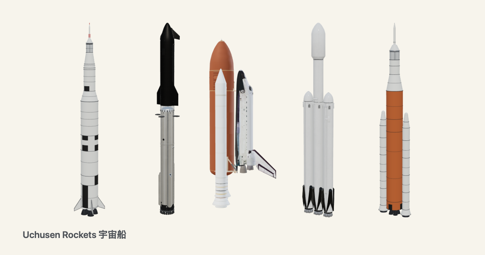</picture></a></p>

<h1 align="center">Uchusen Rockets <sub>宇宙船</sub></h1>

<p align="center"><strong>Rockets drawn from sourced sizes, that you drop into a page, take apart and turn round.</strong><br>
Uchūsen means "spaceship". Each rocket comes in every variant a source documents, each with its own sizes: a line drawing, thick lines and a painted 3D view, together, apart and each part alone, and a typed model that checks whether a rocket really goes together. The SPX fleet ships are original designs.</p>

<p align="center">
  <a href="https://github.com/johnmorrisdotca/uchusen-rockets/actions/workflows/ci.yml"></a>
  <a href="https://www.npmjs.com/package/@johnmorrisdotca/uchusen-rockets"></a>
  <a href="./NOTICE.md"></a>
  
</p>

<p align="center"><a href="https://johnmorrisdotca.github.io/uchusen-rockets/"><strong>Open the demo →</strong></a> · <a href="./docs/variants.md">Variants and sizes</a> · <a href="./docs/parts.md">Build from parts</a> · <a href="./docs/element.md">The element</a> · <a href="./docs/flight.md">Lit engines and flights</a> · <a href="./docs/embed.md">Use one on your site</a> · <a href="./docs/assets.md">Assets</a> · <a href="./docs/guides/getting-started.md">Guides</a> · <a href="https://johnmorrisdotca.github.io/uchusen-rockets/builder.html">Code builder</a> · <a href="https://johnmorrisdotca.github.io/uchusen-rockets/journey.html">Journey mode</a> · <a href="https://johnmorrisdotca.github.io/uchusen-rockets/compare.html">Compare craft</a> · <a href="https://johnmorrisdotca.github.io/uchusen-rockets/docs/">Docs site</a></p>

<p align="center">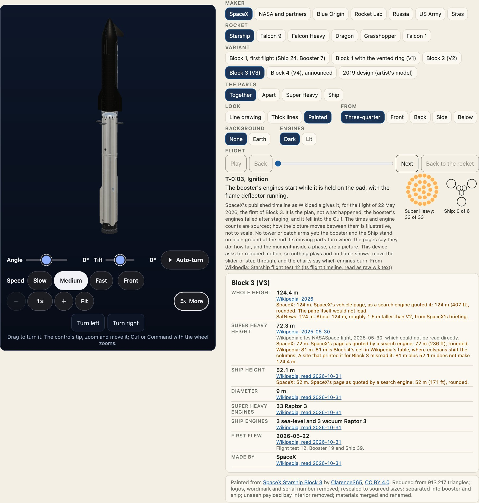</p>

<p align="center">
  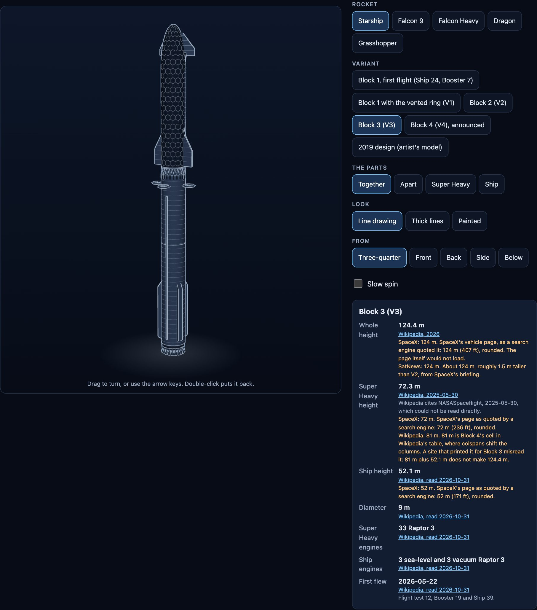
  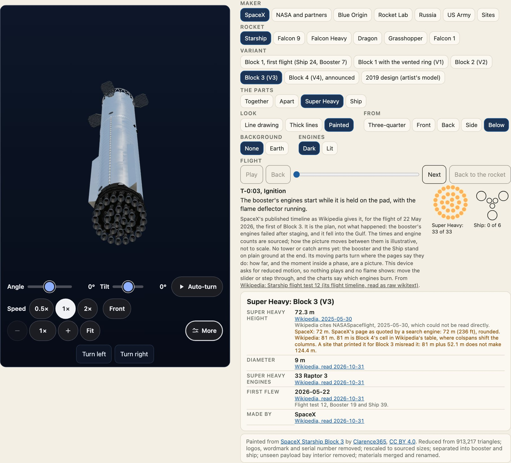
</p>

<p align="center">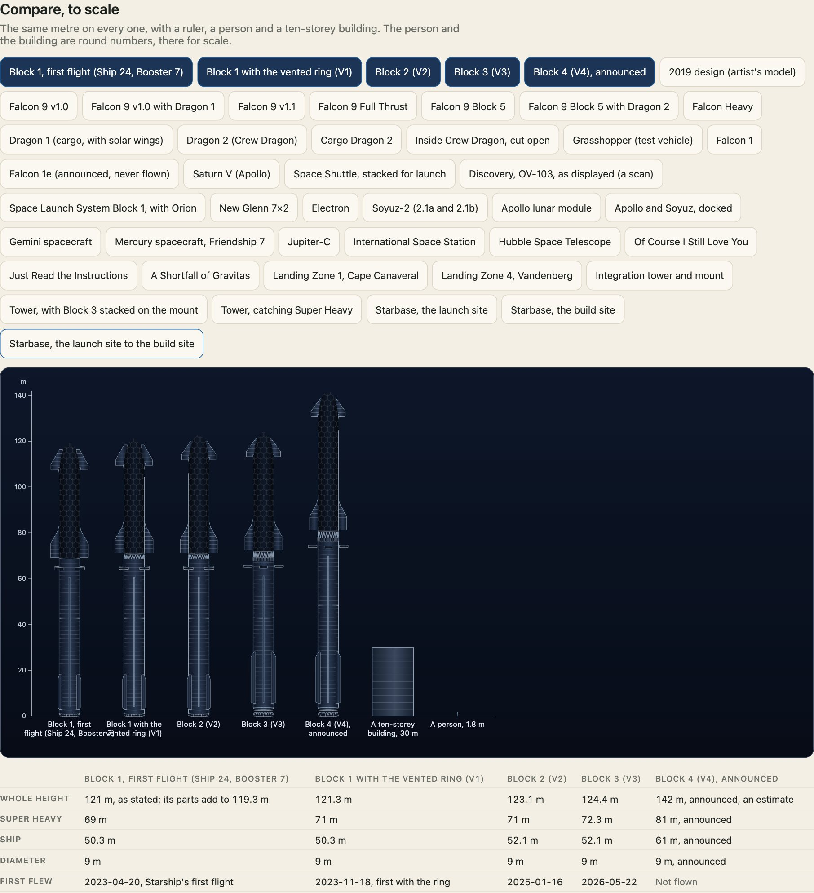</p>

<p align="center">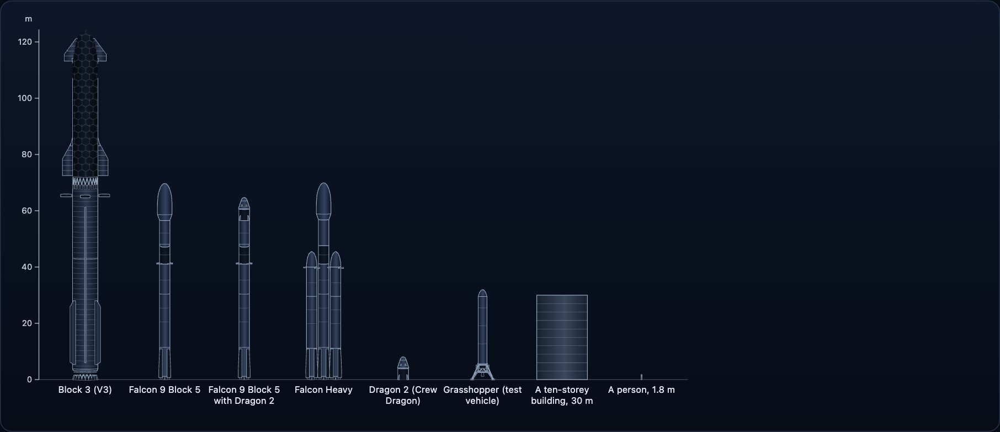</p>

## In 30 seconds

```sh
npm install @johnmorrisdotca/uchusen-rockets three
```

```html
<script type="module">
  import "@johnmorrisdotca/uchusen-rockets/element";
</script>

<uchusen-rocket rocket="starship" variant="v3"></uchusen-rocket>
<uchusen-rocket rocket="starship" variant="v3" show="apart" look="painted" view="back"></uchusen-rocket>
<uchusen-rocket rocket="starship" variant="v2" show="booster" look="thick" view="below"></uchusen-rocket>
```

That is all a page needs with a bundler. The drawing shows at once; when the element comes on screen and the browser can draw WebGL, the 3D view takes over without a jump. Drag to turn it, use the arrow keys, or leave it to its slow spin. `engines="on"` lights each engine at full thrust, in the painted look and as a drawn flame in the line looks, and a reader who asked for reduced motion has them off. A flame's length and its shock diamonds are a picture, not a measurement. `beside="on"` stands Starship with Super Heavy next to the rocket at true scale, to see how big it is. [A flight](docs/flight.md) plays each phase with the engines that burn in it, from published timelines. With no WebGL, under Save-Data, or on any failure, the drawing stays.

## Who it is for

- **A developer who wants a rocket on a page** with one tag, no build step, and a drawing that is there before any 3D has loaded.
- **A writer or teacher** who needs a rocket to scale, beside a person and a building, with every size traceable to a source.
- **A maker of tools** who wants rockets as data: variants, sourced sizes, parts that carry their own joints, and a check that says whether a mix goes together.
- **Anyone who must credit what they show**: a painted rocket's licence travels with it, in every form it is copied.

## Features

- Twenty-three kinds of thing, from Starship to the Hubble Space Telescope, each in every variant a source documents, with its own sizes.
- Three looks (`line`, `thick`, `painted`), five views, together, apart and each part alone, for every one of them.
- A drawing made by code, and a 3D view that takes over without a jump. With no WebGL, under Save-Data or on any failure, the drawing stays.
- Lit engines at full thrust in the colour of what they burn, and flights played phase by phase from published timelines, with grid fins, legs and flaps that turn.
- `check` and `build`: a typed part record, a fit check, a `.glb` mesh and an SVG, in Node or a browser, with no three.js.
- `<uchusen-lineup>`: rockets at one scale with a ruler, a person and a building.
- Six ways to copy a rocket into your own page, with the credit written in.
- A strict content security policy is enough. No network request but the painted model you ask for.

## Use it in your project

```sh
npm install @johnmorrisdotca/uchusen-rockets three
```

```ts no-run
import "@johnmorrisdotca/uchusen-rockets/element";
```

Import the element once, anywhere in your client code, and use the tag. `three` is an optional peer dependency, loaded only for a 3D view. Copy `node_modules/@johnmorrisdotca/uchusen-rockets/dist/assets` to a folder your site serves and call `setAssetBase("/that/folder/")` if you want painted models. [Getting started](docs/guides/getting-started.md) and [React and other frameworks](docs/guides/react-and-frameworks.md) go through it step by step.

## Use it anywhere

A page with no bundler loads the element from a CDN, with an import map for three.js:

```html
<script type="importmap">
  { "imports": { "three": "https://cdn.jsdelivr.net/npm/three@0.186.1/build/three.module.js", "three/addons/": "https://cdn.jsdelivr.net/npm/three@0.186.1/examples/jsm/" } }
</script>
<script type="module" src="https://cdn.jsdelivr.net/npm/@johnmorrisdotca/uchusen-rockets@0/dist/element.js"></script>
<uchusen-rocket rocket="falcon-heavy" look="thick" view="below"></uchusen-rocket>
```

A page that cannot run script uses an iframe of the embed page:

```html
<iframe src="https://johnmorrisdotca.github.io/uchusen-rockets/embed.html?rocket=starship&variant=v3&look=line" title="Starship Block 3" style="width:100%;max-width:480px;aspect-ratio:3 / 4;border:0"></iframe>
```

## Put one on your own site

The drawings are there to be used. The demo copies the code for the rocket on the screen, in six ways: a CDN script and the element, an iframe of the embed page (for a site that cannot run script), a module, the SVG, a data address, and a link to the picture in the package. It saves an SVG or a PNG too. [docs/embed.md](docs/embed.md) has each one.

A painted rocket's CC BY credit is written into every one of those, from the parts that are showing. A line drawing does not carry it, and neither does a variant this package paints itself.

```ts
import { attributesFromOptions, embedCode, optionsFromAttributes, rocketFromParams, rocketToParams } from "@johnmorrisdotca/uchusen-rockets";

const options = { rocket: "falcon-9", variant: "block-5", look: "thick", view: "below", show: "apart" };
const attributes = attributesFromOptions(options);
function read(name) {
  return Object.hasOwn(attributes, name) ? attributes[name] : null;
}
const back = optionsFromAttributes(read);
back.rocket; // "falcon-9"
rocketToParams(options).get("show"); // "apart"
rocketFromParams(rocketToParams(options)).view; // "below"
embedCode(options, "iframe").includes("embed.html"); // true
embedCode({ rocket: "starship", variant: "v3", look: "painted" }, "element").includes("Clarence365"); // true
embedCode({ rocket: "starship", variant: "v3", look: "line" }, "element").includes("Clarence365"); // false
```

| Attribute | Values |
| --- | --- |
| `rocket` | `starship`, `falcon-9`, `falcon-heavy`, `dragon`, `grasshopper`, `falcon-1`, `saturn-v`, `space-shuttle`, `sls`, `new-glenn`, `electron`, `soyuz`, `droneship`, `landing-zone`, `launch-tower`, `starbase`, `lunar-module`, `apollo-soyuz`, `gemini`, `mercury`, `jupiter-c`, `iss`, `hubble` |
| `variant` | Starship: `v1-flight1`, `v1`, `v2`, `v3`, `v4`, `2019`. Falcon 9: `v1.0`, `v1.0-dragon`, `v1.1`, `ft`, `block-5`, `block-5-dragon-2`. Dragon: `dragon-1`, `dragon-2`, `cargo-dragon-2`, `crew-dragon-inside`. Falcon 1: `falcon-1`, `falcon-1e`. Saturn V: `saturn-v`. Space Shuttle: `stack`, `discovery`. Space Launch System: `block-1`. New Glenn: `7x2`. Electron: `electron`. Soyuz: `soyuz-2`. Drone ships: `ocisly`, `jrti`, `asog`. Landing zones: `lz-1`, `lz-4`. Launch tower: `tower`, `stack`, `catch`. Starbase: `launch-site`, `build-site`, `city`. Apollo lunar module: `lunar-module`. Apollo and Soyuz: `apollo-soyuz`. Gemini: `gemini`. Mercury: `friendship-7`. Jupiter-C: `jupiter-c`. International Space Station: `iss`. Hubble Space Telescope: `hubble` |
| `show` | `together`, `apart`, or a part: `booster`, `ship`, `first-stage`, `second-stage`, `fairing`, `trunk`, `capsule`, `centre`, `side-left`, `side-right`, and each rocket's own: `descent`, `ascent`, `csm`, `docking-module`, `soyuz`, `adapter`, `station`, `telescope` and the rest |
| `look` | `line`, `thick`, `painted` |
| `view` | `three-quarter`, `front`, `back`, `side`, `below` |

Changing `look` keeps the angle. Changing `show` is an animated move, and a cut under reduced motion. Each part alone fills the frame and has its own listed size. Every look works for every variant and every choice of parts. Front is the windward, tiled side; back is the steel side.

<p align="center">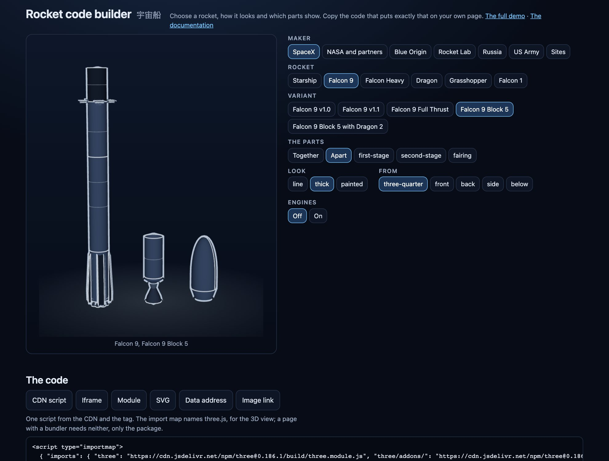</p>

<p align="center">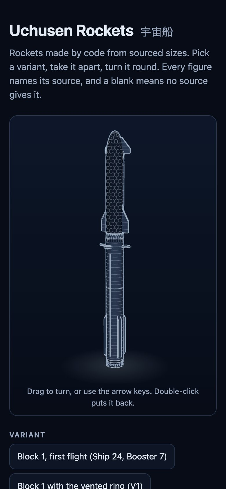</p>

## The rockets

Starship; Falcon 9 in v1.0 (with a fairing, or with Dragon 1 as it flew), v1.1, Full Thrust and Block 5, with a fairing or with Dragon 2; Falcon Heavy; Dragon 1, Dragon 2 and Cargo Dragon 2, and Crew Dragon cut open to see inside; Grasshopper, the test vehicle; and Falcon 1, with the Falcon 1e that was announced and never flew. From other makers, to compare at one scale, each drawn by this package's code from its published sizes: Saturn V; the Space Shuttle, stacked with its tank and boosters, each part alone too, and Discovery, a real scan; the Space Launch System, Block 1 with Orion; New Glenn 7×2; Electron; and Soyuz-2. And where a booster lands: drone ships and landing zones. The Starbase integration tower too, with its mount and arms, a Block 3 stacked on it, or catching its booster. And Starbase, as a scene from the map: `launch-site`, `build-site` and `city`. The Apollo lunar module, painted by NASA's model. Apollo docked to Soyuz, painted by NASA's model, stood on end. The Gemini spacecraft, painted by NASA's model. The Mercury spacecraft, as Friendship 7, painted by NASA's model. Jupiter-C, painted by NASA's model. The International Space Station, painted by NASA's model, of the station as it was when that was made. And the Hubble Space Telescope, painted by NASA's model. <!-- more rockets -->

```html
<uchusen-rocket rocket="falcon-9" variant="block-5" show="apart" look="painted"></uchusen-rocket>
<uchusen-rocket rocket="falcon-9" variant="block-5-dragon-2"></uchusen-rocket>
<uchusen-rocket rocket="falcon-heavy" look="thick" view="below"></uchusen-rocket>
<uchusen-rocket rocket="dragon" variant="dragon-1" show="capsule"></uchusen-rocket>
<uchusen-rocket rocket="grasshopper" look="painted"></uchusen-rocket>
```

The SPX fleet ships are original designs.

ISV Hanabusa, SPX-013, is the fleet's wheel ship: a 589 m keel and a 22 m bow shield, 611 m overall, two rotating propellant booms and three glazed rings of 48, 62 and 76 m radius that step up from the bow (garden, research and living, at 3.43 rpm: 0.63, 0.82 and 1.00 g), with a closed industrial wheel of 112 m radius set apart. Its drive is nineteen magnetic-nozzle thrusters and no bell. It is three variants (the rings stepping up from the bow, the other order, and a flat section view of the living ring) and joins the picker under SPX. The bible is `docs/fleet/ship-01.md`.

<!-- kyotori-class -->
One of them is a class of four, the Kyotori class: ISV 鏡鳥 Kyotori, SPX-045, with ships A, B, C and D (names to be chosen). They share one design and differ like this:

| | Ship A | Ship B | Ship C | Ship D |
|---|---|---|---|---|
| Role | survey and mapping | laboratory | astronomy | crew and medical |
| Hull | the long hull with the payload bay and the glass lift | the short hull with the crew space | the long hull with the payload bay and the glass lift | the short hull with the crew space |
| Its own compartments | two sensor booms with radar, lidar and camera heads | sample labs, a clean room and a cold store | a second telescope on its own mast | extra quarters and a sick bay |
| Instruments | radar, lidar, cameras and star trackers on 34 m booms | two laboratory modules and a refrigerated sample store | a seven-segment mirror with a sun shield | a medical pod with a treatment bay and isolation room |
| Crew | the standard crew | the standard crew and a laboratory staff | the standard crew and an observing staff | the standard crew and about a hundred more |
| Shared | drive of twelve coil rings, tank bouquet, latch frames, bows and docking arms | same | same | same |
| Name | to be chosen (A) | to be chosen (B) | to be chosen (C) | to be chosen (D) |
<!-- kyotori-class -->

One of them is a class of two, the Romurusu class: ISV Miyamoto, SPX-452, and its sister ISV Ariake, SPX-186. They share one hull and differ like this:

| | ISV Miyamoto, SPX-452 | ISV Ariake, SPX-186 |
|---|---|---|
| Role | flagship and command | survey and command |
| Accent | orange | dawn-gold band and pinstripes |
| Signature | a long gold solar array along the starboard side, 10 bays over 120 m of her 380 m | near-black hexagonal panelling on the engine end |
| Nose | more rounded, clad in solar cells | standard |
| Side box modules | the staggered pair (starboard aft, port fore) | all four (port and starboard, fore and aft): double the capacity |
| Default pod | relay (the relief pod on request) | survey |
| Refits | none extra | an extra sensor mast, a second solarium |
| Interior theme | its own: blue and white | warm wood and dawn-gold |
| Shared | hull, drive with shadow-shield collar, decks, length 380 m | same |
| Hangar bodies | two Starship bodies side by side in each box, on cradles | the same, in all four boxes |
| Service | a collar L for a Starship and a collar M for a Dragon, on the ventral side | the service ship: an open berth for a full stack, drawn in two placements, and a methane and oxygen depot |

## Variants, with their sources

Sizes changed over time, so each variant lists its own, as data with types. A variant goes in only if a source documents it. A size no source gives is blank, never estimated. Where sources disagree, the data keeps the one chosen and says what else was said.

```ts
import { SOURCES, variantOf } from "@johnmorrisdotca/uchusen-rockets";

const v3 = variantOf("starship", "v3");
v3.facts.height.value; // 124.4
v3.facts.parts.booster.value; // 72.3
SOURCES[v3.facts.parts.booster.source].publisher; // "Wikipedia"
v3.facts.parts.booster.others.some((other) => other.value === 81); // true
```

| Variant | Whole | Super Heavy | Ship | First flew |
| --- | --- | --- | --- | --- |
| `v1-flight1` Block 1 as it first flew: Ship 24, Booster 7, no ring | 121 m as stated; its parts add to 119.3 m, and it is drawn to them | 69 m | 50.3 m | 2023-04-20, Starship's first flight |
| `v1` Block 1 with the vented ring | 121.3 m | 71 m | 50.3 m | 2023-11-18, the first with the ring |
| `v2` Block 2 | 123.1 m | 71 m | 52.1 m | 2025-01-16 |
| `v3` Block 3 | 124.4 m | 72.3 m | 52.1 m | 2026-05-22 |
| `v4` Block 4, **announced, not built** | 142 m, an estimate | 81 m, announced | 61 m, announced | Not flown |
| `2019` 2019 design (an artist's model, ship only) | 50 m | | 50 m | Never flew |

All are 9 m across, except the 2019 design, for which no source read here gives one. [docs/variants.md](docs/variants.md) has the sources and what they disagree on.

## Build a rocket from parts

Every part from every source has the same record: its real size, its origin and the joints it mates at. Ask whether it fits, with no three.js at all. A mix that fits is built, and is labelled as what it is, never as a vehicle that flew.

```ts
import { check } from "@johnmorrisdotca/uchusen-rockets";

check({ rocket: "starship", variant: "v3" }).label; // "Block 3 (V3)"

const mix = check({ rocket: "starship", variant: "v3", parts: { ship: "starship-v2-ship" } });
mix.ok; // true
mix.custom; // true

const wrong = check({ rocket: "starship", variant: "v3", parts: { booster: "starship-v3-ship" } });
wrong.ok; // false
wrong.issues[0].message; // "Ship, Block 3 (V3) is a ship; this slot takes a booster."
```

```ts
import { build } from "@johnmorrisdotca/uchusen-rockets/build";

const rocket = build({ rocket: "starship", variant: "v3" });
rocket.report.credits[0].creator; // "Clarence365"
rocket.glb().bytes.length > 1000; // true
rocket.svg({ look: "thick", view: "below", show: "booster" }).startsWith("<svg"); // true
```

[docs/parts.md](docs/parts.md) has every part and which source each comes from.

## What is in it

| Entry | What | Needs |
| --- | --- | --- |
| `@johnmorrisdotca/uchusen-rockets` | The rockets and variants (`ROCKETS`, `variantOf`, `SOURCES`, `MAKERS`), the parts (`PART_ENTRIES`), the fit check (`check`), the builder's rows (`builderState`), flights (`flightOf`, `FLIGHTS`) and which engines burn (`pickBells`), the camera rule, the looks, the credits (`MODEL_CREDITS`), and `embedCode` | Nothing |
| `.../build` | `build(description)`, `buildPart(id)`, `lineupSvg`: one mesh and one drawing, in Node or a browser | Nothing |
| `.../element` | `<uchusen-rocket>`, `<uchusen-lineup>` and `<uchusen-flight>`: load `three` only when a 3D view is wanted, and a painted model only when the painted look is | `three` for 3D |
| `.../react` | A thin `<UchusenRocket>` wrapper | `react` |
| `.../assets/*` | Ready files: `starship-v3.glb`, `starship-v3.svg`, `starship-v3-booster.thick.svg`, `parts/raptor-vacuum.glb`, `models/starship-v3-ship.glb` | Nothing |

## To scale

`<uchusen-lineup>` stands rockets on one baseline at one scale, with a ruler, a person and a building.

```html
<uchusen-lineup items="starship:v1,starship:v2,starship:v3,starship:v4,building,person" unit="3" ruler labels></uchusen-lineup>
```

## React

```jsx
import { UchusenRocket } from "@johnmorrisdotca/uchusen-rockets/react";

<UchusenRocket rocket="starship" variant="v3" show="apart" look="thick" />;
```

## Licences, credits and a word on trademarks

The code, the code-made meshes and the drawings are under the MIT licence. **The painted models are not: they stay under Creative Commons Attribution 4.0, or public domain where the row says so, and using them means crediting them.** `check(description).credits` says which belong to a rocket.

```ts
import { check } from "@johnmorrisdotca/uchusen-rockets";

check({ rocket: "starship", variant: "v3" }).credits[0].licence; // "CC BY 4.0"
```
 **Starbase's coordinates and outlines, its map heights and the tower's 13 m footprint are © OpenStreetMap contributors, under ODbL 1.0, not MIT** (https://www.openstreetmap.org/copyright).

| Painted | Title | Creator | Source | Changed |
| --- | --- | --- | --- | --- |
| Block 3 | SpaceX Starship Block 3 | [Clarence365](https://sketchfab.com/clarence365) | [Sketchfab](https://sketchfab.com/3d-models/spacex-starship-block-3-6f6c6f88a3eb4b4d822fdca66733fbb2) | Reduced, logos and serial number removed, rescaled to sourced sizes, parts separated |
| Block 1 as it first flew | Spacex Starship Ship 24 & Booster 7 V4 | [clarence365](https://sketchfab.com/clarence365) | [Sketchfab](https://sketchfab.com/3d-models/spacex-starship-ship-24-booster-7-v4-97875d14b63e4b9ca9ed425ef4253306) | Reduced, logo, serial number and decals removed, rescaled to sourced sizes, parts separated |
| 2019 design | SpaceX Starship | [MartianDays](https://sketchfab.com/MartianDays) | [Sketchfab](https://sketchfab.com/3d-models/spacex-starship-a8a0b69f776841a1a465cd9fb3762fd2) | Rescaled to the sourced height, turned to this package's axes |

| Falcon 9 Block 5 | Falcon 9 - SpaceX | [Stanley Creative](https://sketchfab.com/Stanley_Creative) | [Sketchfab](https://sketchfab.com/3d-models/falcon-9-spacex-394f7cf52d124bbd9db69f24d1ff2f08) | Reduced, wordmark, logos and flags removed, rescaled to sourced sizes, parts separated |
| Dragon 2 | SpaceX - Dragon 2 | [KUBAHA](https://sketchfab.com/KUBAHA) | [Sketchfab](https://sketchfab.com/3d-models/spacex-dragon-2-1b125e30a2cb442288580290536fbe5d) | Reduced, rescaled to sourced sizes, parts separated |
| Dragon 1 | SpaceX Cargo Dragon | [ProgressTH](https://sketchfab.com/ProgressTH) | [Sketchfab](https://sketchfab.com/3d-models/spacex-cargo-dragon-0ca8951e47b343dc8a41e23b3e9c55e5) | Merged, logo and hidden pressure vessel removed, rescaled to sourced sizes, parts separated |
| Falcon Heavy | SpaceX Falcon Heavy(Low Poly) | [Antonio_Adams](https://sketchfab.com/AAdams3112) | [Sketchfab](https://sketchfab.com/3d-models/spacex-falcon-heavylow-poly-0dc068a462e34258b3872085a7f592c8) | Wordmark and logos painted out, rescaled to sourced sizes, side boosters separated |
| Grasshopper | SpaceX Grasshopper | [Echo_3](https://sketchfab.com/Echo_3) | [Sketchfab](https://sketchfab.com/3d-models/spacex-grasshopper-35c07a68cdb246c59bb425610b934bf8) | Wordmark and logo removed, rescaled to the sourced height, reduced |

| Discovery | Orbiter, Space Shuttle, OV-103, Discovery | [Smithsonian Institution, National Air and Space Museum](https://3d.si.edu/) | [Smithsonian 3D](https://3d.si.edu/object/3d/orbiter-space-shuttle-ov-103-discovery:d8c636ce-4ebc-11ea-b77f-2e728ce88125) | Marks painted out, reduced, stood upright, rescaled to the sourced length. Under CC0 |

| Space Shuttle, stacked | Shuttle (Hi-Res) and Shuttle Parts (Hi-Res) | [NASA](https://science.nasa.gov/3d-resources/) | [Orbiter](https://data.nasa.gov/dataset/nasa-3d-models-shuttle-hi-res), [tank and boosters](https://data.nasa.gov/dataset/nasa-3d-models-shuttle-parts-hi-res) | Marks painted out, bay shut, reduced, stood upright, rescaled to the sourced lengths. Public domain |
| Apollo lunar module | Apollo Lunar Module | [NASA](https://science.nasa.gov/3d-resources/) | [data.nasa.gov](https://data.nasa.gov/dataset/nasa-3d-models-apollo-lunar-module) | Flag and name removed, reduced, rescaled to the sourced height, its stages separated. Public domain |
| Apollo and Soyuz, docked | Apollo Soyuz | [NASA](https://science.nasa.gov/3d-resources/) | [data.nasa.gov](https://data.nasa.gov/dataset/nasa-3d-models-apollo-soyuz) | Flags and names painted out, reduced, rescaled to the sourced sizes, stood on end, its craft separated. Public domain |
| Gemini | Gemini | [NASA](https://science.nasa.gov/3d-resources/) | [data.nasa.gov](https://data.nasa.gov/dataset/nasa-3d-models-gemini) | Flag and name painted out, reduced, rescaled to the sourced length, its parts separated. Public domain |
| Mercury, Friendship 7 | Friendship 7 | [NASA](https://science.nasa.gov/3d-resources/) | [data.nasa.gov](https://data.nasa.gov/dataset/nasa-3d-models-friendship-7) | Reduced, rescaled to the sourced sizes, its colours judged from photographs. Public domain |
| Jupiter-C | Jupiter-C | [NASA](https://science.nasa.gov/3d-resources/) | [data.nasa.gov](https://data.nasa.gov/dataset/nasa-3d-models-jupiter-c) | Lettering removed, rescaled to the sourced height. Public domain |
| International Space Station | ISS | [NASA](https://science.nasa.gov/3d-resources/) | [data.nasa.gov](https://data.nasa.gov/dataset/nasa-3d-models-iss) | Reduced, stray pieces left out, rescaled to the sourced length, its colours judged from photographs. Public domain |
| Hubble Space Telescope | Hubble Space Telescope | [NASA](https://science.nasa.gov/3d-resources/) | [data.nasa.gov](https://data.nasa.gov/dataset/nasa-3d-models-hubble-space-telescope) | A lettered plate painted out, rescaled to the sourced length. Public domain |
| Cluster II, the drum | Cluster II | [NASA 3D Resources](https://science.nasa.gov/3d-resources/) | [science.nasa.gov](https://science.nasa.gov/3d-resources/cluster-ii/) | Foil, booms and pictures left out, so no mark is shipped. Already the sourced 2.9 m by 1.3 m. Public domain |
<!-- more NASA models -->

All but Discovery and NASA's are under [CC BY 4.0](https://creativecommons.org/licenses/by/4.0/). NASA is named as the source of its models, as its guidelines ask, with no suggestion that it endorses this package, and no NASA logo, insignia, flag or lettering is shipped: [NOTICE.md](NOTICE.md) says what that rests on. Starship Blocks 1, 2 and 4 and the older Falcon 9s are painted by this package's own code: no model is stretched to stand in for another version.

**No mesh or drawing carries a logo, a wordmark or a flag.** Rocket names appear only as plain descriptive words. All trademarks belong to their owners, and this project is not affiliated with or endorsed by SpaceX, NASA or any other maker or agency named here. [NOTICE.md](NOTICE.md) names each source and what was taken from it.

## Examples

Every `ts` block in this README and in the guides runs against the built package (`pnpm test:readme`).

```ts
import { check, variantOf } from "@johnmorrisdotca/uchusen-rockets";

const falcon = variantOf("falcon-9", "block-5");
falcon.facts.height.value; // 69.8
check({ rocket: "falcon-9", variant: "block-5" }).ok; // true
check({ rocket: "falcon-9", variant: "block-5" }).custom; // false
```

```ts
import { showsOf, variantOf } from "@johnmorrisdotca/uchusen-rockets";

showsOf(variantOf("falcon-9", "block-5").slots).includes("apart"); // true
```

```ts
import { lineupSvg } from "@johnmorrisdotca/uchusen-rockets/build";

const picture = lineupSvg({ items: ["starship:v3", "falcon-9:block-5", "person"], unit: 4, ruler: true, labels: true });
picture.items.length; // 3
picture.svg.startsWith("<svg"); // true
```

```ts
import { cleanLook, cleanView } from "@johnmorrisdotca/uchusen-rockets";

cleanLook("shiny"); // "line"
cleanView("below"); // "below"
```

Anything from outside is treated as text: an attribute that is not in its list falls back to the default and nothing else.

## The code builder

[The code builder](https://johnmorrisdotca.github.io/uchusen-rockets/builder.html) is one screen: choose the maker, the rocket, the variant, the parts, the look, the view and the engines, see the rocket, and copy the code for any of the six ways, or for React, Vue, Angular and Svelte. The demo's "Put this rocket on your site" is the same panel (the family's `<kazoku-embed-panel>`): a size, the drawing beside the code, Save SVG and Save PNG, Open the embed page and Read the docs. A painted rocket's credit is under the code. It is built from `ROCKETS`, `showsOf`, `embedCode` and `paintedCredit`, so it offers every rocket the package has, as it gains them.

## Lit engines and flights

```html
<uchusen-rocket id="rocket" rocket="falcon-9" variant="block-5" look="painted" engines="on"></uchusen-rocket>
<uchusen-flight for="rocket"></uchusen-flight>
```

<p align="center">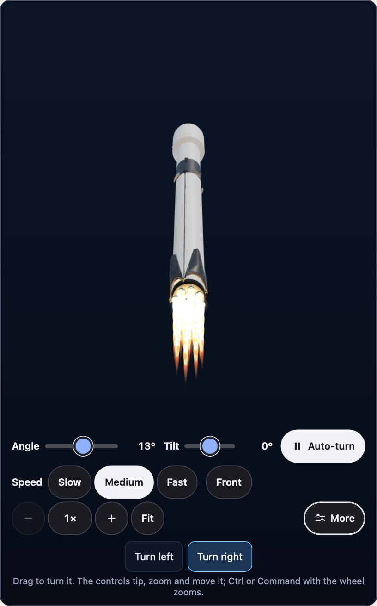</p>

<p align="center">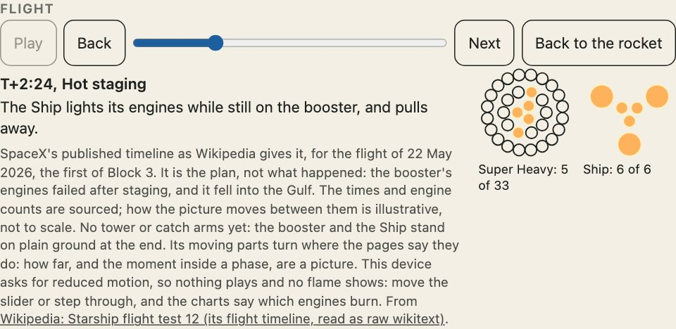</p>

`engines="on"` lights each engine that shows, in the colour of what its engine burns (each from a page), and a flight lights only the engines that burn in each phase, from a published timeline, with the altitude and speed where its page gives them. Grid fins, legs and flaps turn in a flight where the pages say they do. How the picture moves between phases, how far a part turns, and a flame's length, is illustrative; the times, counts, altitudes and speeds are sourced. [The guide](docs/guides/engines-and-flights.md) has the details.

## NASA's models

The Apollo lunar module, Apollo docked to Soyuz, Gemini, Mercury, Jupiter-C, the Space Shuttle, the International Space Station and the Hubble Space Telescope are painted by NASA's own public-domain models, each with its marks removed and its sizes set from a source.

<p align="center">
  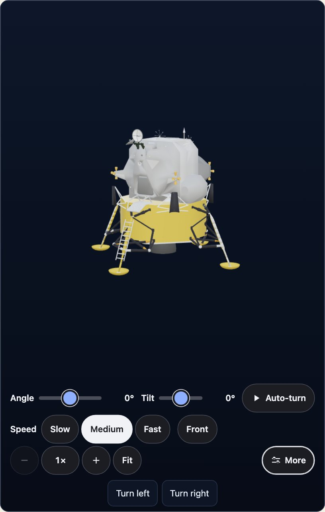
  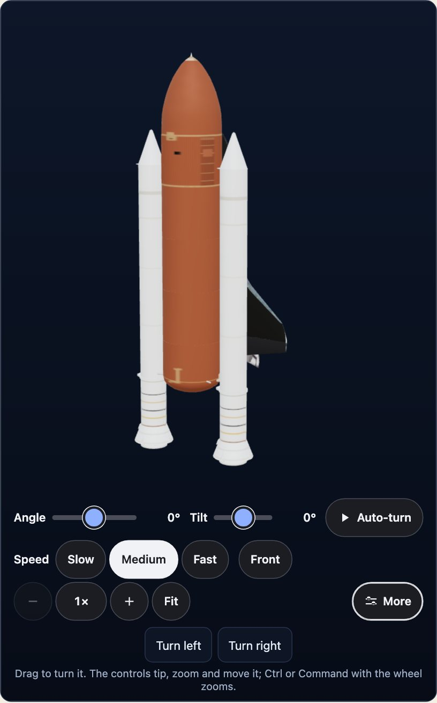
</p>

## API

The reference is a site, made from the source's own doc comments: every export has a summary, its parameters, what it returns, and an example that runs when the site is built. [Open the reference](https://johnmorrisdotca.github.io/uchusen-rockets/docs/).

```ts
import { ROCKETS, PART_ENTRIES, SOURCES, MODEL_CREDITS } from "@johnmorrisdotca/uchusen-rockets";

Object.keys(ROCKETS).length > 20; // true
PART_ENTRIES.length > 100; // true
Object.keys(SOURCES).length > 20; // true
Object.keys(MODEL_CREDITS).length > 10; // true
```

<p align="center">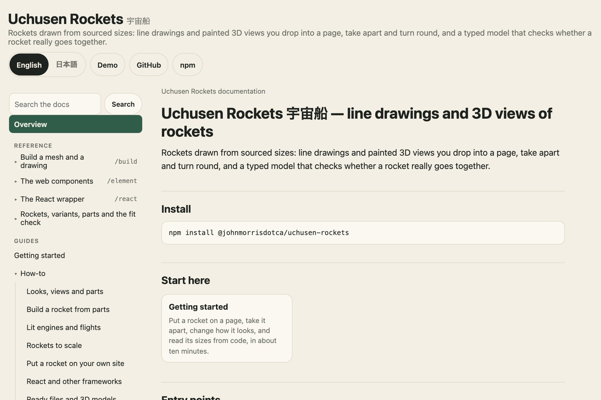</p>

## Guides

Each guide has a Japanese twin in [docs/guides/ja](docs/guides/ja).

| Guide | What it is for |
| --- | --- |
| [Getting started](docs/guides/getting-started.md) | A rocket on a page in ten minutes |
| [Looks, views and parts](docs/guides/looks-views-and-parts.md) | The three choices that change what you see |
| [Build a rocket from parts](docs/guides/build-from-parts.md) | Part records, the fit check, `build`, the builder |
| [Lit engines and flights](docs/guides/engines-and-flights.md) | Engines at full thrust, flights, what is sourced |
| [Rockets to scale](docs/guides/scale-lineups.md) | `<uchusen-lineup>` and `lineupSvg` |
| [Journey mode](docs/guides/journey.md) | Fly a rocket or a fleet ship to the Moon or a planet: windows, burns, the flip |
| [Put a rocket on your own site](docs/guides/embed-on-your-site.md) | Six ways, and the credit |
| [React and other frameworks](docs/guides/react-and-frameworks.md) | React, Vue, Svelte, Angular |
| [Bundlers and CDNs](docs/guides/bundlers-and-cdn.md) | unpkg, Vite, webpack |
| [TypeScript and Node](docs/guides/typescript-and-node.md) | Types, and the core in Node |
| [Bundlers and CDNs](docs/guides/bundlers-and-cdn.md) | unpkg, Vite, webpack |
| [TypeScript and Node](docs/guides/typescript-and-node.md) | Types, and the core in Node |
| [Ready files and 3D models](docs/guides/assets-and-3d-files.md) | The `.glb` and `.svg` files |
| [Variants and sourced sizes](docs/guides/variants-and-sources.md) | Why a figure names its source |
| [Licences, credits and trademarks](docs/guides/licences-and-credits.md) | What is MIT, CC BY, public domain, ODbL |
| [Architecture](docs/guides/architecture.md) | How the layers fit |
| [Troubleshooting](docs/guides/troubleshooting.md) | Why the 3D view or the model is missing |
| [Upgrading](docs/guides/upgrading.md) | What to look for between versions |

## Limits

- A rocket is only as good as its sources. A figure no source gives is blank, never estimated, and a blank is shown as one.
- A flame's length and its shock diamonds, how parts move between flight phases, smoke and the ground falling away are pictures, not measurements.
- A part with no licensed model is painted by this package's own code from photographs and sizes. It is a likeness, not a scan.
- A flight exists only for the variants a published timeline covers. A custom build has none.
- A painted model is up to 8 MB and is fetched only when asked for. Code-made meshes stay under 600 KB and drawings under 80 KB.
- There is no logo, wordmark or flag on anything, so a rocket is never "the real livery".

```ts
import { variantOf } from "@johnmorrisdotca/uchusen-rockets";

variantOf("starship", "2019").facts.diameter.value; // null
```

## Accessibility

- The element has an accessible name from its `label` attribute, or from the fit report's label (such as "Block 3 (V3)") when there is none. The 3D view's canvas says how to turn it.
- A reader who asked for reduced motion gets no spin, no flames, no played flight and a cut instead of an animated move. The slider and charts still work.
- Turning works by drag, touch and the keyboard: the arrow keys turn it, the wheel over the view, a pinch, `+` and `-` zoom, Home puts it back. With the pointer anywhere else the wheel scrolls the page, and so it does when the zoom is already at its end.
- The demo's controls are at least 44 pixels tall and work with a keyboard.

```html
<uchusen-rocket rocket="starship" variant="v3" label="Starship Block 3, taken apart" show="apart"></uchusen-rocket>
```

## Browser and runtime support

- Using the package needs Node 22 or later. Working on it needs 22.18 or later.
- In a browser, any current one. The 3D view needs WebGL; without it the drawing stays.
- The test suite runs the demo in Chromium and WebKit at a phone's width and a desk's, and the packed package on Linux, macOS and Windows, on Node 22 and 24.
- `three` `>=0.170.0` and `react` `>=18` are optional peer dependencies.

## Languages

The documentation is in English and Japanese: each guide in [docs/guides](docs/guides) has a twin in [docs/guides/ja](docs/guides/ja), and the documentation site switches between them. The rockets' own names are plain descriptive words and are the same in both.

## Architecture

The data is typed once. A part is a table of numbers: its real size in metres and the joints it mates at. A mesh and a drawing come from the same pieces, so they cannot disagree with each other or with the data. The root and `build` entries import neither three.js nor the DOM; the element loads three.js only for a 3D view.

```ts
import { build } from "@johnmorrisdotca/uchusen-rockets/build";

const a = build({ rocket: "falcon-9", variant: "block-5" }).glb().bytes;
const b = build({ rocket: "falcon-9", variant: "block-5" }).glb().bytes;
a.length === b.length; // true
```

A mesh is a pure function of its description: the same description gives the same bytes. [Architecture](docs/guides/architecture.md) has the layers.

## Development

```sh
pnpm install
pnpm check          # lint, types, tests, the build and the packed package
pnpm test:readme    # run every example of the README, the docs and the guides
pnpm test:usage     # every way to use it (CDN, Vite, webpack, React, Vue, Svelte, Angular, iframe, TypeScript, Node), built and opened from the package as npm packs it
pnpm test:usage     # every way to use it (CDN, Vite, webpack, React, Vue, Svelte, Angular, iframe, TypeScript, Node), built and opened from the package as npm packs it
pnpm docs:check     # the reference site's checks: every export documented, every example run
pnpm test:demo      # the demo in a real browser
pnpm dev            # the demo on http://127.0.0.1:7900/uchusen-rockets/
pnpm screenshots    # the pictures in docs/images
```

## Contributing

Bug reports, ideas and pull requests are welcome: see [CONTRIBUTING.md](CONTRIBUTING.md). The rules that matter most: a figure names its source or is blank, no logos or marks, a mesh is a pure function of its description, and anything from outside is text.

## Changes

[CHANGELOG.md](CHANGELOG.md) lists every release with its date.

## Roadmap

`PLANNED_ROCKETS` lists rockets with sourced facts and no shape yet: Vulcan Centaur and Ariane 6.

```ts
import { PLANNED_ROCKETS } from "@johnmorrisdotca/uchusen-rockets";

PLANNED_ROCKETS.map((rocket) => rocket.id).length > 0; // true
```

A rocket goes in only when a source documents it.

## The family

<!-- family:start (made by scripts/family-readme.mjs from scripts/family-template.mjs; change those, not this) -->
Uchusen Rockets is one of thirty-five packages, each made for the same site, each at
[github.com/johnmorrisdotca](https://github.com/johnmorrisdotca) or [github.com/spxis](https://github.com/spxis). The code of every one is MIT.

**Games — board**

- [Domino](https://github.com/johnmorrisdotca/domino) (ドミノ): dominoes and Mexican Train. [Demo](https://johnmorrisdotca.github.io/domino/).
- [Gunjin](https://github.com/johnmorrisdotca/gunjin) (軍人): five hidden-rank strategy games with pass-the-device play. [Demo](https://johnmorrisdotca.github.io/gunjin/).
- [Narabe](https://github.com/johnmorrisdotca/narabe) (並べ): one rules engine for abstract board games, from gomoku and Reversi to Go and checkers. [Demo](https://johnmorrisdotca.github.io/narabe/).
- [Sugoroku](https://github.com/johnmorrisdotca/sugoroku) (双六): backgammon and its variants, with the doubling cube and match play. [Demo](https://johnmorrisdotca.github.io/sugoroku/).
- [Tenka](https://github.com/johnmorrisdotca/tenka) (天下): world conquest for two to six, on a map of the real world. [Demo](https://johnmorrisdotca.github.io/tenka/).

**Games — cards & tiles**

- [Hitotsu](https://github.com/johnmorrisdotca/hitotsu) (一つ): a colour-card shedding game for two to eight, with the house rules people play. [Demo](https://johnmorrisdotca.github.io/hitotsu/).
- [Jarajara](https://github.com/johnmorrisdotca/jarajara) (ジャラジャラ): mahjong tiles drawn as SVG, stacked layouts, and the matching solitaire Awase. [Demo](https://johnmorrisdotca.github.io/jarajara/).
- [Kumimoji](https://github.com/johnmorrisdotca/kumimoji) (組み文字): a crossword tile race, in English and Japanese kana. [Demo](https://johnmorrisdotca.github.io/kumimoji/).
- [Toranpu](https://github.com/johnmorrisdotca/toranpu) (トランプ): a deck of playing cards, card games with computer players, and solitaires. [Demo](https://johnmorrisdotca.github.io/toranpu/).

**Games — puzzles**

- [Houseki](https://github.com/johnmorrisdotca/houseki) (宝石): gem and stone matching puzzles: falling triplets, stone collapse, colour chains and gem swap. [Demo](https://johnmorrisdotca.github.io/houseki/).
- [Jirai](https://github.com/johnmorrisdotca/jirai) (地雷): minesweeper on shaped grids with verified no-guess boards. [Demo](https://johnmorrisdotca.github.io/jirai/).
- [Karakuri](https://github.com/johnmorrisdotca/karakuri) (からくり): eight hyper-casual puzzle games, some of them physics: draw a shield, pull pins, cut ropes, slide blocks, pour tubes. [Demo](https://johnmorrisdotca.github.io/karakuri/).
- [Kazu](https://github.com/johnmorrisdotca/kazu) (数): grid number puzzles: Sudoku and its variants, Futoshiki and Skyscrapers. [Demo](https://johnmorrisdotca.github.io/kazu/).
- [Kyuubu](https://github.com/johnmorrisdotca/kyuubu) (キューブ): a turning cube for the browser, 2×2 to 7×7, with record solves to replay. [Demo](https://johnmorrisdotca.github.io/kyuubu/).
- [Meikyuu](https://github.com/johnmorrisdotca/meikyuu) (迷宮): mazes on squares, hexagons, triangles and circles, made from a seed and drawn through with a finger or the mouse. [Demo](https://johnmorrisdotca.github.io/meikyuu/).
- [Suido](https://github.com/johnmorrisdotca/suido) (水道): a pipe puzzle: turn the pieces until the water reaches every drain. [Demo](https://johnmorrisdotca.github.io/suido/).
- [Tobiishi](https://github.com/johnmorrisdotca/tobiishi) (飛び石): peg solitaire with nine boards and seeded solvable challenges. [Demo](https://johnmorrisdotca.github.io/tobiishi/).
- [Tsunagi](https://github.com/johnmorrisdotca/tsunagi) (繋ぎ): a line-joining logic puzzle whose every level has exactly one answer. [Demo](https://johnmorrisdotca.github.io/tsunagi/).

**Games — dice & random**

- [Korokoro](https://github.com/johnmorrisdotca/korokoro) (コロコロ): dice, with notation, exact odds, real sounds and the dice of many games. [Demo](https://johnmorrisdotca.github.io/korokoro/).
- [Tane](https://github.com/johnmorrisdotca/tane) (種): seeded random numbers and daily seeds, the same in every browser and on every server. [Demo](https://johnmorrisdotca.github.io/tane/).

**Language**

- [Bushu](https://github.com/johnmorrisdotca/bushu) (部首): find a kanji by the parts it is made of. [Demo](https://johnmorrisdotca.github.io/bushu/).
- [Hikidashi](https://github.com/johnmorrisdotca/hikidashi) (引き出し): a drawer of small Japanese text tools: era dates, kanji numerals, readings and sentence difficulty. [Demo](https://johnmorrisdotca.github.io/hikidashi/).
- [Kotoba](https://github.com/johnmorrisdotca/kotoba) (言葉): word lists and word-game rules in English, French, German and Japanese. [Demo](https://johnmorrisdotca.github.io/kotoba/).

**Geography & data**

- [address-plus](https://github.com/johnmorrisdotca/address-plus) (アドレスプラス): parse and format addresses in the United States, Canada, Japan, Australia, France, Germany and the United Kingdom. [Demo](https://johnmorrisdotca.github.io/address-plus/).
- [Chikyu Earth](https://github.com/johnmorrisdotca/chikyu-earth) (地球): a line-drawn globe that turns at the Earth's own rate, with an optional realistic Earth from space and markers for any place. [Demo](https://johnmorrisdotca.github.io/chikyu-earth/).
- [Chizu](https://github.com/johnmorrisdotca/chizu) (地図): maps of the world and of countries' regions, in English and Japanese, with a quiz and callouts. [Demo](https://johnmorrisdotca.github.io/chizu/).
- [Hata](https://github.com/johnmorrisdotca/hata) (旗): country and regional flags as SVG, at their true proportions and keyed by ISO code. [Demo](https://johnmorrisdotca.github.io/hata/).
- [Kuni](https://github.com/johnmorrisdotca/kuni) (国): countries and their regions, with ISO codes and names in English and Japanese. [Demo](https://johnmorrisdotca.github.io/kuni/).
- [Uchusen Rockets](https://github.com/johnmorrisdotca/uchusen-rockets) (宇宙船): rockets drawn from sourced sizes, as line drawings and 3D views you can take apart and turn, with a check that a rocket really goes together. [Demo](https://johnmorrisdotca.github.io/uchusen-rockets/).
- [Wakusei Planets](https://github.com/johnmorrisdotca/wakusei-planets) (惑星): the Sun, the planets and their moons, as line drawings, shaded drawings and painted surface maps, with their real sizes, tilt and rotation. [Demo](https://johnmorrisdotca.github.io/wakusei-planets/).

**Sports**

- [Dougu Sports](https://github.com/johnmorrisdotca/dougu-sports) (道具): sports emblems as SVG: trophies, medals, crests, and the ball and gear of every sport, with optional 3D turning. [Demo](https://johnmorrisdotca.github.io/dougu-sports/).
- [Kyogijo Stadiums](https://github.com/johnmorrisdotca/kyogijo-stadiums) (競技場): sports fields, rinks, courts and ballparks drawn to scale as SVG, with each team and the score on them. [Demo](https://johnmorrisdotca.github.io/kyogijo-stadiums/).
- [Senshu Jerseys](https://github.com/johnmorrisdotca/senshu-jerseys) (選手): sports jerseys, sweaters, kits, caps, helmets and retired-number banners as SVG, front and back, with optional 2.5D turning. [Demo](https://johnmorrisdotca.github.io/senshu-jerseys/).
- [Taisen Brackets](https://github.com/johnmorrisdotca/taisen-brackets) (対戦): a sport-agnostic tournament bracket, drawn as SVG, from a list of ties. [Demo](https://johnmorrisdotca.github.io/taisen-brackets/).

**Developer tools**

- [REST in Pieces](https://github.com/spxis/rest-in-pieces) (レスト・イン・ピーシーズ): seeded test data and REST APIs for frontend development, with latency and error drills. [Demo](https://spxis.github.io/rest-in-pieces/).


**This package is Uchusen Rockets.** The demos of all thirty-five share one header and footer, so each links the rest.
<!-- family:end -->

## The rest

[CONTRIBUTING.md](CONTRIBUTING.md) · [SECURITY.md](SECURITY.md) · [CHANGELOG.md](CHANGELOG.md) · [NOTICE.md](NOTICE.md) · MIT licence, CC BY 4.0 for the painted models, and ODbL 1.0 for the map data
