# ISV 加美鳴 Kaminari, SPX-207

The public hull is the Quiver. This page is the first design, kept in full at `docs/fleet/ship-02-original.md` and opened by address as `fleet-02-original`.

**加美鳴（かみなり） · Kaminari · "thunder"**. Role: 大型輸送船 (large transport ship). In the programme's words: "Large transport ship. It carries heavy cargo in a giant hull, and its engines' low growl echoes like distant thunder."

ISV 加美鳴 Kaminari, SPX-207 is a planned ship of the SPX fleet: the dates, figures and technologies here are the programme's planned figures. It is an original design, built in code from tables of metres (`src/model/fleet/ship-02/`).

| | |
|---|---|
| Designation | SPX-207 |
| Operator | SPX |
| Class | IHT, Interstellar Heavy Transport |
| Main drive | FTD, Fusion Torch Drive |
| Computer | KAZE core v4 (Kinetic Autonomous Zonal Executive) |
| Small craft | ATC (Auxiliary Transfer Craft) |
| Maker | SPX (no logo or wordmark on the hull, only the designation text) |
| Design started / keel to be laid / first flight | 2507 / 2511 at the orbital yard / 2520 (planned) |
| Status | PLANNED · first flight 2520 |

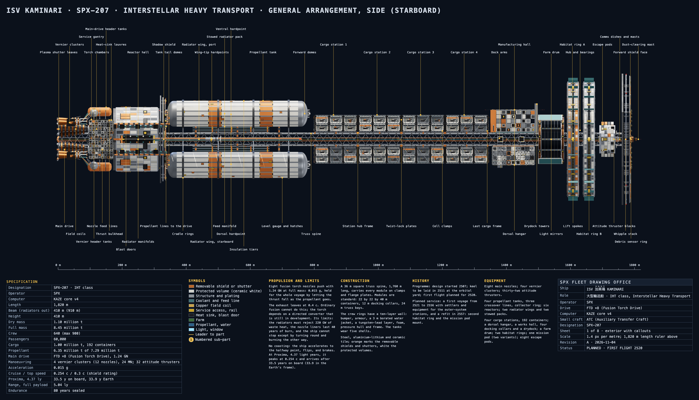

## Specification

| | |
|---|---|
| Length | 1,820 m (tail to the tip of the bow mast) |
| Beam | 410 m at the bow shield; 910 m with both radiator wings out |
| Height | 410 m |
| Dry mass | 1.10 million t (module table in `dims.ts`) |
| Full mass | 8.45 million t: dry, 1.00 million t of payload, 6.35 million t of propellant |
| Crew | 640 nominal, 900 maximum |
| Passengers | 60,000: 24,000 awake in two rings and 36,000 in cold-sleep berths |
| Cargo | 1.00 million t in 192 containers (22 by 22 by 40 m) |
| Propellant | 6.35 million t loaded, of 7.29 million t tank capacity (four tanks, 80 m by 440 m) |
| Endurance | 80 years sealed (closed water and air loops, farms, 60 years of stores) |

Fleet scale: Waymark (SPX-03) is 380 m by 118 m by 74 m and 105,000 t, so ISV 加美鳴 Kaminari, SPX-207 is about 4.8 times as long and 80 times as heavy. It is about six times the length of a 300 m cruiser of any franchise.

## The programme

Planned after the outer-system stations asked for one ship that could carry a station's worth of parts and the people to run it. Design starts in 2507, the keel is to be laid in 2511 at the orbital yard, and the first flight is planned for 2520, the longest build in the fleet. Its first voyage, planned for 2521 to 2556, carries settlers and equipment to the outer-system stations. A refit planned for 2557 adds the second habitat ring and the mission pod mount. The plan is steady and slow: this ship is not meant to hurry.

## Layout, bow to stern

A 36 m square truss spine, 1,760 m long, carries every module on clamps and flange plates. The silhouette is a long spine with four propellant tanks standing in the corners of a cross at the tail, two flat radiator wings between them, a train of cargo stations, a dock, a farm, two spinning rings and a layered shield at the bow. It has no wings and no tower; it reads from every side as a freight spine, nothing like SPX-03's stepped hangar shoulders.

Sixty-three named sections (`sections.ts`, one for every 29 m on average) and 29 numbered decks (`specs.ts`):

| Decks | Part |
|---|---|
| 1 to 5 | Forward shield and dust mast; comms and sensor deck; bridge; command crew deck; sick bay and escape pods |
| 6 to 12 | Habitat rings B and A, three decks each (homes, streets, parks), and the hub with its bearings |
| 13 to 15 | Farm drum, three terraces and the light mirrors |
| 16 to 17 | Drydock and dorsal hangar; manufacturing hall and stores |
| 18 to 21 | Four cargo stations of 48 containers |
| 22 to 23 | Mission pod and radiator packs; the four propellant tanks |
| 24 to 29 | Propellant lines and collector ring; shadow shield; six reactors; thrust bulkhead and heat sinks; eight torch nozzles; four vernier clusters |

Every module and every deck is its own part, so each can be shown alone from the picker (see the parts list below). Every deck of the numbered summary has a part of its own: the decks inside the rings, the farm, the citadel and the dock are one part to a deck.

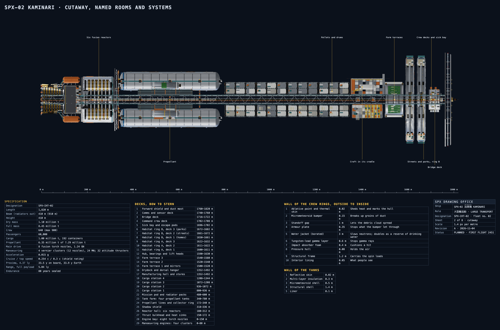

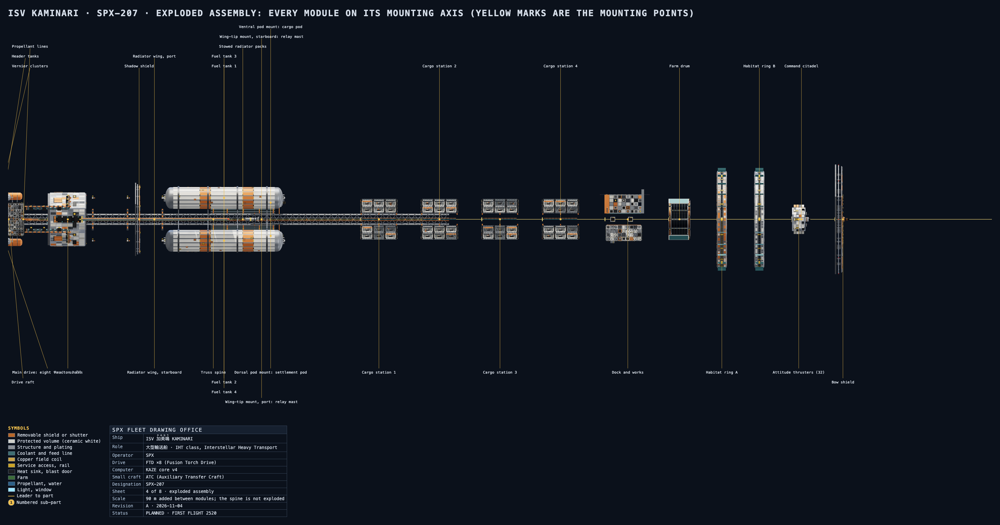

## What each module descends from

Real hardware is the starting point, not a cage: every module names the real thing it grew from and what it adds a few centuries on. The silhouette is unchanged; the surfaces are white blanket and foil with colour kept small and functional (orange only on removable shields and shutters, yellow only on service access and handrails, a stripe only where something has to be found), and every pipe, strut and rail is a round tube.

| Module | Descends from | What it adds |
|---|---|---|
| Truss spine | The ISS's integrated truss and NASA's nuclear Mars transfer vehicle studies (an open truss carrying tanks, reactor, habitat and radiators) | Round tube chords and struts, 24 m bays, 1,760 m long |
| Drive raft and torch nozzles | The thrust structure and feed plumbing of Saturn V's engine bay and Starship (gimbal actuators, feed lines, heat shield) | Eight torch bells with copper field coils and shutter leaves |
| Reactor hall and shadow shield | NASA's nuclear thermal rocket studies: a reactor behind a shield disc, crew behind that | Six reactors, a ten-shell wall with a water jacket |
| Propellant tanks and lines | Saturn V and Starship tanks (domed barrels, insulation tiers), the Shuttle's external tank | Four 80 m tanks, cross-fed by round pipes with flanges and bends |
| Radiator wings | The ISS's radiators on booms and the big radiators of the Mars transfer studies | Six panels a wing, tube rows on both faces, a folded pack as spare |
| Cargo stations | The ISS truss payload sites and the Shuttle's payload bay racks; the shipping container | 192 standard 22 by 22 by 40 m containers, mostly white blanket |
| Habitat rings and farm drum | Spun-habitat studies (the Stanford torus), the ISS pressurised modules, NASA plant-growth chambers | Two counter-rotating rings at half a gravity, a glazed farm drum |
| Dock and works | The ISS docking system and the Shuttle's robotic arm | Standard 12 m collars, a gantry crane, a drydock |
| Command citadel and bow shield | Orion's crew module and the ISS's Whipple shield; the multi-layer foil of Hubble and JWST | An armoured eight-sided keep, a three-plate shield |
| Header tanks, verniers and attitude thrusters | Starship's header tanks, the Shuttle's RCS clusters and the lunar module's four-bell RCS quads | Four spheres, twelve vernier bells, thirty-two attitude bells |
| Mission pods | Orion's service module and ISS modules on a common berthing mechanism | Two pod mounts, five modules that swap |

Pipes, struts and rails follow the package's own parts such as the lunar module's legs: round tubes with joint fittings and end caps. Struts are round with end plates, posts are I-beams, handrails are round tube on round posts, and pipes rise out of the hull through rounded bends and run on brackets with flanges. `ship-02-pipes-beside-lunar-module.png` shows a pipe run and a strut beside the lunar module's descent stage.

## Parts list (one stated scale: metres)

Every part is placed by its own origin, on the ship's axis (y from the tail, x to starboard, z up). One scale: metres; the viewer shows a scale bar and the sheets a length ruler. "Inside" parts are the cutaway's contents, one per deck or room.

| Part | What it is | Kind | Starts at y (m) | Length (m) |
|---|---|---|---|---|
| `spine` | Truss spine | spacecraft | 0 | 1760 |
| `drive` | Drive raft | engine | 0 | 232 |
| `drive-engines` | Main drive: eight torch nozzles | engine | 0 | 150 |
| `verniers` | Vernier clusters | engine | 0 | 130 |
| `header-tanks` | Header tanks | tank | 0 | 170 |
| `reactor` | Reactor hall | service-module | 172 | 150 |
| `shadow-shield` | Shadow shield | fairing | 318 | 30 |
| `propellant-lines` | Propellant lines | adapter | 0 | 341 |
| `tank-1` | Fuel tank 1 | tank | 340 | 440 |
| `tank-2` | Fuel tank 2 | tank | 340 | 440 |
| `tank-3` | Fuel tank 3 | tank | 340 | 440 |
| `tank-4` | Fuel tank 4 | tank | 340 | 440 |
| `radiator-starboard` | Radiator wing, starboard | arms | 200 | 560 |
| `radiator-port` | Radiator wing, port | arms | 200 | 560 |
| `radiators-stowed` | Stowed radiator packs | arms | 420 | 240 |
| `pod` | Dorsal pod mount: settlement pod | service-module | 480 | 148 |
| `pod-ventral` | Ventral pod mount: cargo pod | service-module | 480 | 148 |
| `tip-port` | Wing-tip mount, port: relay mast | mount | 480 | 80 |
| `tip-starboard` | Wing-tip mount, starboard: relay mast | mount | 480 | 80 |
| `cargo-1` | Cargo station 1 | mount | 800 | 136 |
| `cargo-2` | Cargo station 2 | mount | 936 | 136 |
| `cargo-3` | Cargo station 3 | mount | 1072 | 136 |
| `cargo-4` | Cargo station 4 | mount | 1208 | 136 |
| `dock` | Dock and works | deck | 1352 | 170 |
| `farm` | Farm drum | ring | 1500 | 80 |
| `habitat-a` | Habitat ring A | ring | 1590 | 36 |
| `habitat-b` | Habitat ring B | ring | 1640 | 36 |
| `command` | Command citadel | spacecraft | 1690 | 70 |
| `attitude-thrusters` | Attitude thrusters (32) | engine | 1690 | 50 |
| `shield` | Bow shield | fairing | 1760 | 60 |
| `reactor-inside` | Reactors, inside | inside (cutaway) | 172 | 158 |
| `tank-inside` | Propellant and tank works, inside | inside (cutaway) | 340 | 440 |
| `cargo-inside` | Cargo, inside the containers | inside (cutaway) | 800 | 544 |
| `dock-hangar` | Hangar and craft in its cradle, inside | inside (cutaway) | 1352 | 140 |
| `dock-works` | Manufacturing hall and stores, inside | inside (cutaway) | 1352 | 140 |
| `farm-terrace-1` | Farm terrace 1, inside | inside (cutaway) | 1500 | 80 |
| `farm-terrace-2` | Farm terrace 2, inside | inside (cutaway) | 1500 | 80 |
| `farm-terrace-3` | Farm terrace 3, inside | inside (cutaway) | 1500 | 80 |
| `habitat-a-deck-1` | Habitat ring A, deck 1 (homes), inside | inside (cutaway) | 1590 | 40 |
| `habitat-a-deck-2` | Habitat ring A, deck 2 (streets), inside | inside (cutaway) | 1590 | 40 |
| `habitat-a-deck-3` | Habitat ring A, deck 3 (parks), inside | inside (cutaway) | 1590 | 40 |
| `habitat-b-deck-1` | Habitat ring B, deck 1 (homes), inside | inside (cutaway) | 1640 | 40 |
| `habitat-b-deck-2` | Habitat ring B, deck 2 (streets), inside | inside (cutaway) | 1640 | 40 |
| `habitat-b-deck-3` | Habitat ring B, deck 3 (parks), inside | inside (cutaway) | 1640 | 40 |
| `command-bridge` | Bridge deck, inside | inside (cutaway) | 1690 | 50 |
| `command-crew` | Command crew deck, inside | inside (cutaway) | 1690 | 50 |
| `command-medbay` | Sick bay, inside | inside (cutaway) | 1690 | 50 |

Beside them: the five alternate modules that fit the hardpoints (below) and two engines on their own, `ship-02-nozzle-main` and `ship-02-vernier-cluster`, drawn for the propulsion cards.

## Mission hardpoints and named variants

Three named hardpoints turn one hull into four ships. Each takes a module of the same size, mounting on the same three clamp arms and the same 12 m collar, and each variant is the standard part list with other modules swapped in (`SHIP_02_VARIANT_PARTS`).

| Hardpoint | Standard module | Other modules that fit |
|---|---|---|
| Dorsal pod mount (slot `pod`) | Settlement pod | Survey pod, tanker pod |
| Ventral pod mount (slot `pod-ventral`) | Cargo pod | Laboratory pod, rescue pod |
| Wing-tip mounts (slots `tip-port`, `tip-starboard`) | Relay mast | Tug |

| Variant | Dorsal | Ventral | Wing tips |
|---|---|---|---|
| Heavy Transport (standard) | Settlement pod | Cargo pod | Relay masts |
| Survey configuration | Survey pod | Laboratory pod | Relay masts |
| Tanker configuration | Tanker pod | Cargo pod | Tugs |
| Rescue configuration | Settlement pod as a refuge | Rescue pod | Tugs |

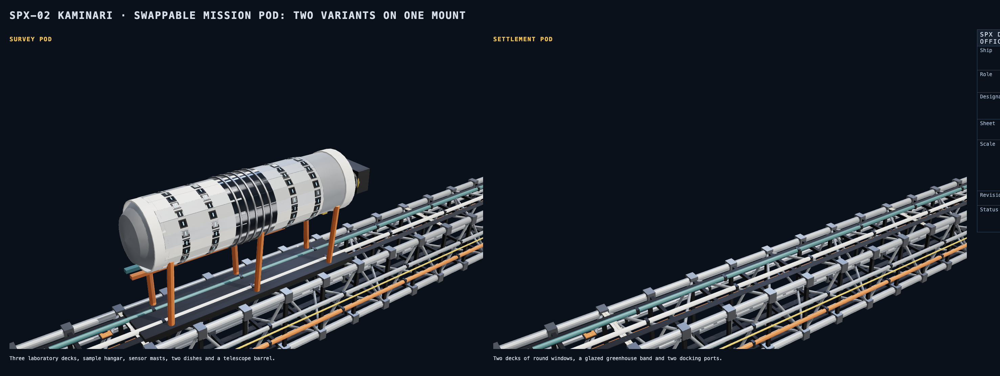

## Header tanks and attitude thrusters

Four spherical vernier header tanks (7,500 t each, 12.8 m radius) stand at the raft's corners with bleed lines to their verniers; two cylindrical main-drive headers hold an 800 t start charge each, on brackets along the raft's top and bottom faces. The 32 attitude thrusters are four blocks of eight small bells at the citadel's corners, a part of their own.

## The viewer: labels, panel and insets

In the web component, a ship that has an `inspector` in its data gets a panel under the picture:

- **Tabs**: specification, propulsion and limits, construction, history, equipment (the bible's notes), and insets.
- **Labels** (button, or the attribute `labels="on"`): the 63 section names in 3D, each following its part as the model turns and hiding with it.
- **Download 3D model**: saves the full-detail .glb of the ship on screen (see Making the pictures).
- **Insets**: a click flies to a system (reactor core, navigation and sensors, life support, docking ports, cargo handling, farms, habitat ring), shows the right parts (the inside parts instead of the shell that covers them) and numbers six sub-parts; "Back to the whole ship" returns. `inspector="off"` leaves the panel out.

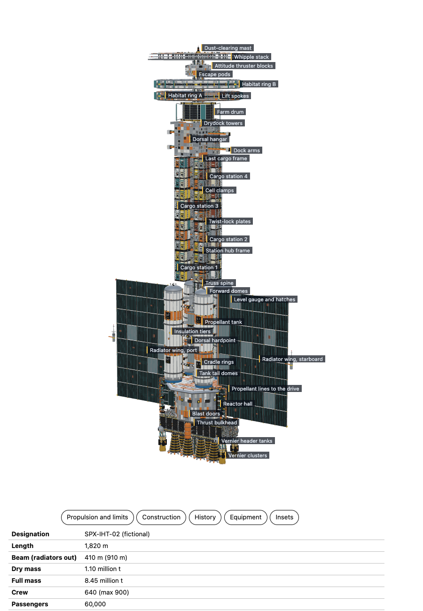

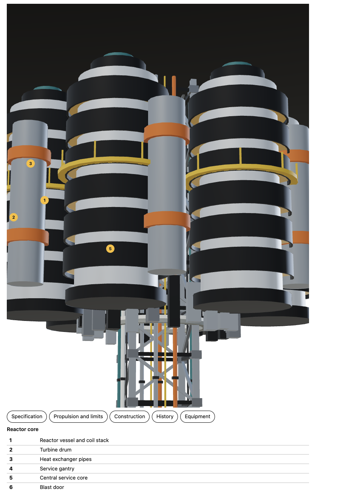

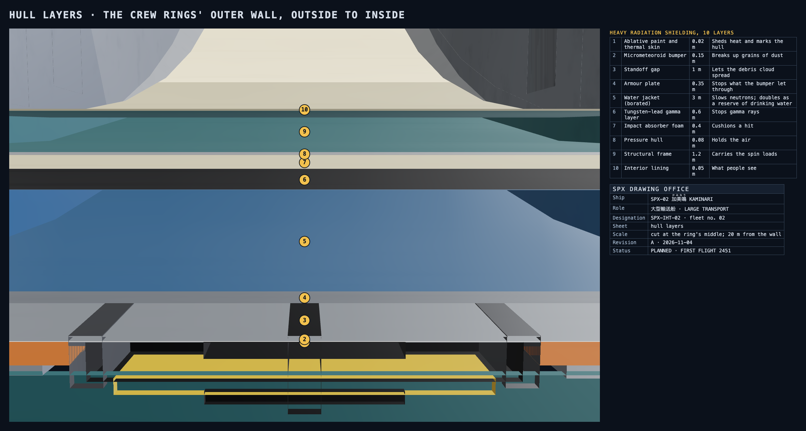

## Propulsion and its limits

**Mechanism.** A fusion torch with a directed converter still in development. It exhausts a lithium-boron slurry at an effective **0.4 c**. Ordinary fusion exhausts at a few per cent of c; the converter is the programme's main risk, and everything else is arithmetic from it.

| Engine | Count | Thrust, each | Specific impulse | Operation |
|---|---|---|---|---|
| Fusion torch nozzle, main drive (50 m lip) | 8 | 155 MN (1.24 GN together at full mass) | 12.2 million s | Continuous for the whole voyage, thrust falling with mass to hold 0.015 g |
| Vernier cluster of 3 nozzles, manoeuvring | 4 | 6 MN (24 MN together) | 40,000 s | Pulsed: steering, docking, the flip |
| Attitude thrusters, command citadel | 32 | 40 kN | 3,000 s | Pulsed, from the nitrogen reserve |

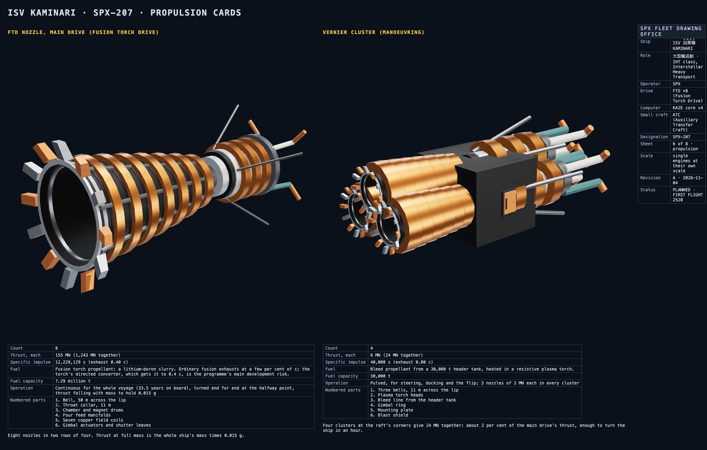

**Limits.** The jet power at the start is 74.5 PW. Essentially all of it must leave in the exhaust: the radiators (two wings of 6 panels, 560 m by 56 m, both faces) reject 220 GW of waste heat, and a nozzle fault that dumps even 0.01 per cent of the jet into the hull overwhelms them and aborts the burn. The nozzle liners last 40 years of burn. The ship cannot stop except by turning end for end and burning the other way, and the verniers cannot do the braking.

## Performance and the voyage

Relativistic constant proper acceleration, with the ship turned end for end at the halfway point of the distance and the same acceleration used to brake. For distance D and acceleration a, the rapidity at the flip is `eta = acosh(1 + aD / 2c^2)`, the peak speed `c tanh(eta)`, the time on board `2 c eta / a`, the time in the frame of the two ends `2 c sinh(eta) / a`, and the ideal mass ratio `exp(2 eta / 0.4)`. `src/model/fleet/ship-02/journey.ts` is that arithmetic; `test/ship-02.test.ts` pins every number below.

| | |
|---|---|
| Maximum acceleration | 0.015 g (0.147 m/s squared) |
| Cruise (peak) speed on the Proxima route | 0.2537 c, at the flip |
| Theoretical top speed | 0.30 c, the rating of the forward shield (the fuel alone would allow 0.39 c with no payload) |
| Earth to Proxima Centauri, 4.37 ly | **33.50 years on board, 33.88 years in the Earth's frame** |
| Mass ratio for that trip | 3.658: 8.45 million t at departure, 2.31 million t at arrival, 0.21 million t of propellant left |
| Range with a full payload, to rest | 5.04 ly; about 9.6 ly with no payload |

**The trade-off, in one line.** Faster needs more unproven physics, slower is safer. At 0.010 g the trip is 41.1 years; at 0.020 g, 29.0 years (the same as Waymark); at 0.050 g, 18.2 years but a mass ratio of 10.5, which this ship's tanks could not carry. 0.015 g is the choice: a ship that carries 60,000 people should not hurry, and its mass ratio of 3.66 just fits the tanks.

## Hull layers

Heavy radiation shielding. The crew rings' outer wall, outside to inside (real separate shells at the cut edge, `HULL_STACK_RING`): 1 ablative paint and thermal skin 0.02 m; 2 micrometeoroid bumper 0.15 m; 3 standoff gap 1.0 m; 4 armour plate 0.35 m; 5 borated water jacket 3.0 m (also the drinking-water reserve); 6 tungsten-lead gamma layer 0.6 m; 7 impact foam 0.4 m; 8 pressure hull 0.08 m; 9 structural frame 1.2 m; 10 interior lining 0.05 m. The tanks wear five shells (`HULL_STACK_TANK`) and the reactor hall five nested octagons.

## System insets (each with six numbered parts)

Reactor core; navigation and sensor suite; life support; docking ports; cargo handling; farms; habitat ring. See `INSETS` in `specs.ts` and the `inset_*` sheets from `scripts/fleet-render.ts`.

## Detaching at the destination (a later ticket)

For the story, the settlement pod or a habitat ring separates at the destination to become a station while the transport returns. Nothing is built for this yet; this is the plan for the later ticket.

| Joint | What separates | Hardware it needs |
|---|---|---|
| The dorsal pod mount (three clamp arms and the 12 m collar) | The settlement pod, 120 m long, with its own supplies | Explosive-free release latches on the three arms and the collar, a collar plug for the transport's side, an umbilical disconnect, and the pod's own attitude thrusters and a header tank to move off |
| A habitat ring's hub bearings (the ring and its six spokes) | Ring A or ring B, 330 m across, with 12,000 people | A spoke-root separation ring at the hub, the spin brought to a stop first, lift-tube hatches that seal both sides, a power and water coupling, a tug pair to take the ring clear |
| The cargo stations' clamp girders | A cargo station of 48 containers | Twist-lock releases on the girders and a gantry crane to hand the cells off |

The farm drum and the ring share a spine hub, so the ring goes first and the farm follows only with a second release at the drum's end bearing.

## Strengths, weaknesses and limits

Strengths: by far the largest hull in the fleet; redundant everything (six reactors, four tanks with crossover lines, two rings); carries a small town and a station's parts at once; swappable mission pod. Weaknesses: slow (decades to anywhere), a heavy shield for a narrow cone, a long fragile spine, and a drive whose heat budget leaves no margin. Operating limits: 0.015 g, 0.30 c, 40 years of nozzle liner, a flip that takes about an hour on the verniers.

## Influences and originality check

| Influence | What is used | Originality check |
|---|---|---|
| Real spaceflight | Truss spines, shadow shields, spun rings, borated-water shielding, cargo racks | No real vehicle outline or marking |
| Japanese space anime | Battleship-scale mass, engines built into the hull, dense mechanical surface | No bow tower, no nautical prow, no wing |
| Star Trek tradition | Named decks, labelled sections, modular engine bays | The nearest franchise cruiser (about 300 m) is a saucer and two nacelles: nothing here is a disc, a pair of nacelles or a borrowed deck plan |
| Star Wars tradition | Heavy plating, exposed pipes and hangars, scale | No wedge plan, no tower, no copied bay layout |

The reference pictures are mood only. Nothing is traced; every shape is built in code from numbers.

## Notes

- **Propulsion and limits**: above.
- **Construction**: standard parts everywhere: 22 by 22 by 40 m containers, 12 m docking collars (`collar`), 24 m truss bays. Steel, aluminium-lithium and ceramic tile; orange marks the removable shields and shutters, white the protected volumes, yellow the service access.
- **Equipment list**: 8 main nozzles, 4 vernier clusters, 32 attitude thrusters; 4 propellant tanks, 3 crossover lines, a collector ring; 6 reactors; 2 radiator wings and 2 stowed packs; 4 cargo stations (192 containers); a dorsal hangar, a works hall, 4 docking collars and a drydock; a farm drum; 2 habitat rings; 1 mission pod, 2 variants; 8 escape pods.

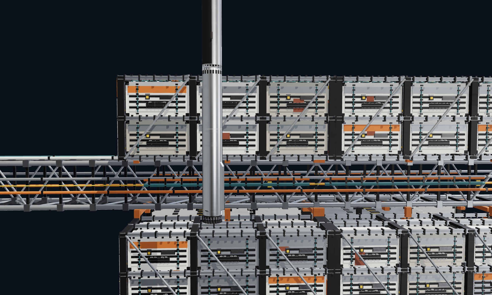

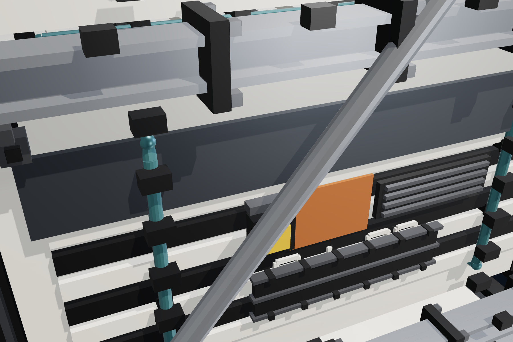

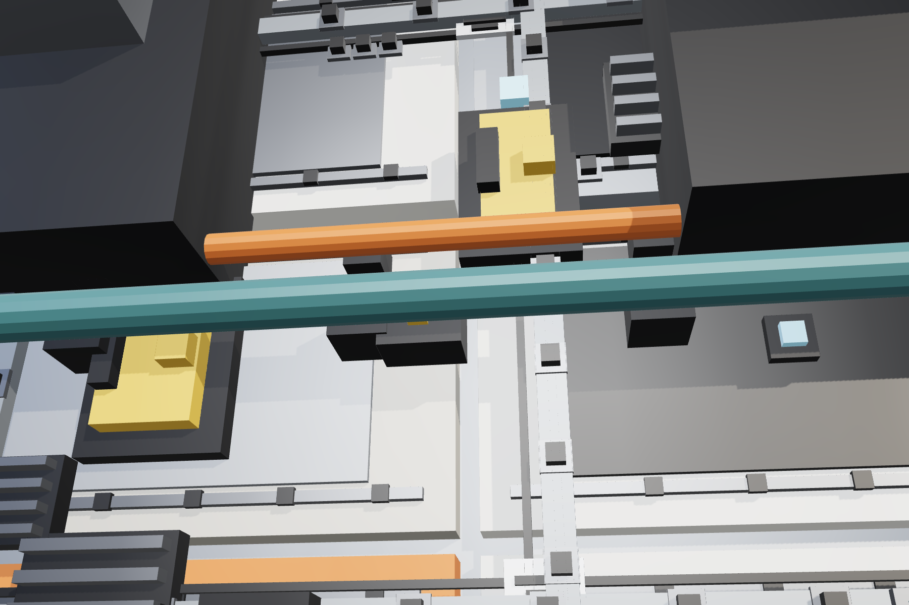

## Making the pictures

`node scripts/fleet-render.ts <folder>` draws every render and sheet from the real model, in one headless browser in software.

**Size, decided by John.** A fleet ship's full-detail mesh is far larger than the package's 600 KB mesh limit (the whole ship is tens of megabytes), so fleet ships (a flag kept in the data, shown nowhere) ship **no prebuilt .glb** and only light drawings (under 80 KB, simple stand-ins for the detail). The 3D view is built in code at run time. The viewer's panel has a **Download 3D model** button that makes the full-detail .glb on demand from the ship on screen (the whole ship, or the one part shown alone), with `build().glb()` in the browser; `test/ship-02.test.ts` opens an exported file and checks that its parts and triangle counts match. The exemption is in `scripts/make-assets.ts`, `scripts/check-package.ts` and `test/build.test.ts`.

## Build time and memory, and the budget

A fleet ship is built in the browser, so the cost is measured and held to a budget: **the first picture within 1 s and full detail within 3 s** on a normal laptop. Measured (Node, warm; the page in software GL as a pessimistic bound):

| | Time | Size |
|---|---|---|
| First picture: the drawing from the coarse build | 0.20 s in Node. In the page: 1.45 s to the drawing, but a Falcon 9 takes 1.42 s in the same harness, so the ship adds about 0.03 s | 73 KB of drawing |
| Coarse 3D (structure and every piece over 6 m) | 0.05 s to the mesh | 424,000 triangles, 14 MB |
| Full detail (every piece) | 0.2 s to build, 0.6 s to the mesh | 2.34 million triangles, 94 MB |
| First 3D frame in software GL | 4.3 s (Falcon 9: 3.4 s) | |
| Memory in the page after the first frame | 149 MB of JavaScript heap (it was 1,121 MB before the changes below) | |

How it stays inside the budget:

- **Coarse first.** The element builds the ship at the coarse level (`build(description, { detail: "coarse" })`), leaving out the small 3D-only detail (`src/model/detail.ts`).
- **Fine when close.** The full level is built once, when the camera first comes near, when an inset opens, or when one part is shown alone; never on a turn or a look change.
- **No big meshes kept.** A part with over 2,000 pieces is measured from its pieces and meshed only when its triangles are asked for, and the mesh is not kept (`HEAVY_PIECES`). Boxes share their outlines and axes.
- **Download 3D model** always builds the full level, whatever is on screen.

`test/ship-02.test.ts` fails if the first picture takes over 1 s, the coarse mesh over 1.5 s or full detail over 3 s in Node, or if the coarse level stops being under a third of the fine one.
