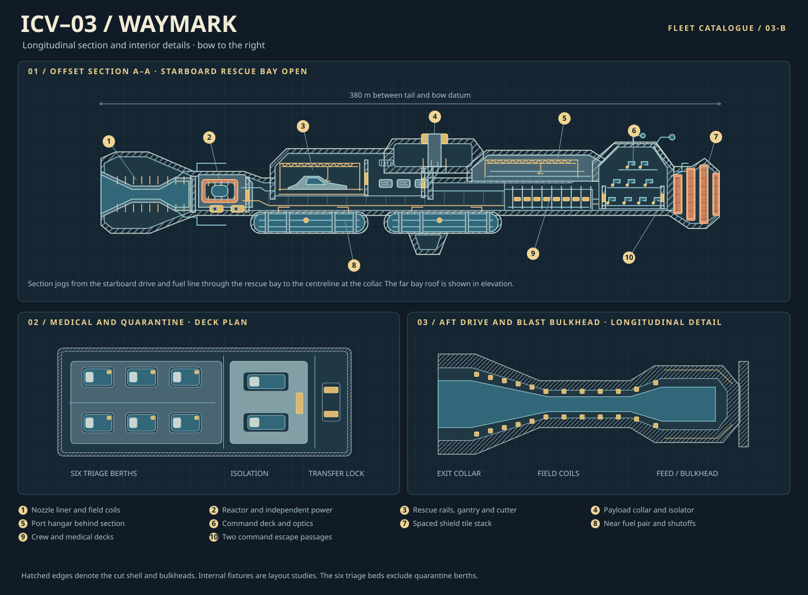

# ISV 宮本 MIYAMOTO · SPX-452

**宮本 · Miyamoto** — "at the foot of the shrine". Flagship. The stately ship that commands the whole fleet.

| | |
|---|---|
| Designation | ISV Miyamoto, SPX-452 · Romurusu class (ロムルス級, "after Romulus"), ICV type (Interstellar Command Vessel), flagship and command |
| Operator | SPX |
| Ship computer | KAZE core v4 (Kinetic Autonomous Zonal Executive) |
| Status | PLANNED · FIRST FLIGHT 2456 |
| Programme | Approved 2448 · keel laid at the orbital yard 2452 (planned) · first flight 2456 (planned) · entry into service 2459 (planned) |

Every number on this page is a design target of the programme. The ship is built in code from tables of metres in `src/model/fleet/ship-03/` and joins the other craft of the package as variants: stowed, radiators out, relief pod, cutaway and no collar for Miyamoto, and Ariake whole and cut open.

Title block: *ISV Miyamoto, SPX-452 · Romurusu class · ICV · SPX · DCD ×2 · KAZE core v4*

## The hangar bays

Both bays of Miyamoto (and each of Ariake's four) are empty: the craft that fly from them (the ATC rescue cutter and the survey craft) are designed separately. What stands in the bays is hangar hardware: a cradle with six clamp arms (hydraulic cylinder, column and padded jaw) and hazard chocks, round guide rails on I-beam sleepers from the cradle out through the door, an overhead gantry crane on I-beam rails, an umbilical boom with fuel, coolant and power hoses to a connector head and a hose reel, deck markings, and eight floodlights. The starboard bay has one large cradle, the port bay three smaller ones. The bay door reads as a door: a heavy grey frame with a second dark frame inside it, corner gussets and bolt rows; a heavy I-beam track along the lintel and the sill that the leaves run on; shutter leaves of orange slats (the only orange on the door) drawn into a stack, with hinge barrels and two hydraulic actuators each; a clear opening seam where the leaves stop (a dark gap, a tall hazard-striped leading edge, and a column of red and amber lamps); a roller housing above the door; and frame lights down both jambs and along the lintel. The racks on the wall that faces the spine are real shelving: steel uprights every seven metres, eight shelf boards with a front lip, standard cases in three neutral colours (white, grey, blue-grey) with a label, a handle and a hinge line, a strap across each shelf and a net of straps down each bay.

## The Romurusu class: Miyamoto and Ariake

The Romurusu class (ロムルス級) has two ships: ISV Miyamoto, SPX-452, and ISV 有明 Ariake (ありあけ), SPX-186, "daybreak". They share one model: the same hull, drive with its shadow-shield collar, decks and length (380 m). Each is a variant record that shares every part it does not change, with its own name, registry and hull marks (the registry digits on the bow), and each appears in the picker as its own row under SPX. Ariake's title block reads *ISV Ariake, SPX-186 · Romurusu class · ICV · SPX · DCD ×2 · KAZE core v4*. How they differ (the table is written once, in `CLASS_TABLE` in `specs.ts`, and a test holds the variant records to it):

| | ISV Miyamoto, SPX-452 | ISV Ariake, SPX-186 |
|---|---|---|
| Role | flagship and command | survey and command |
| Accent | orange | dawn-gold band and pinstripes |
| Signature | a long gold solar array along the starboard side, 10 bays over 120 m of her 380 m | near-black hexagonal panelling on the engine end |
| Nose | more rounded, clad in solar cells | standard |
| Side box modules | the staggered pair (starboard aft, port fore) | all four (port and starboard, fore and aft): double the capacity |
| Default pod | relay (the relief pod on request) | survey |
| Refits | none extra | an extra sensor mast, a second solarium |
| Interior theme | its own: blue and white | warm wood and dawn-gold |
| Shared | hull, drive with shadow-shield collar, decks, length 380 m | same |
| Hangar bodies | two Starship bodies side by side in each box, on cradles | the same, in all four boxes |
| Service | a collar L for a Starship and a collar M for a Dragon, on the ventral side | the service ship: an open berth for a full stack, drawn in two placements, and a methane and oxygen depot |

What sets Miyamoto apart:

- **A long gold solar array along the starboard side.** Ten bays on a root beam, 120 m of her 380 m, built like the ISS's wings and iROSA: a rotary joint (a ring gear and a motor) at each end of the beam that turns the wing to face the star, a beta gimbal and a hinge to each bay, and, deployed, a lattice mast 56 m long with a blanket of gold cells each side of it (5,832 square metres of cells on kapton, in rows, with edge wires, a tension bar and a take-up box). Stowed, each bay folds into a gold-foil canister on the beam. Two states, `array-stowed` and `array-deployed` (the variant "solar array out"); the corner it fills is the one Ariake fills with a hangar box. The cells are one template of size and thickness, built as raised plates.
- **Power from the array.** About 2.1 MW(e) at one astronomical unit from a Sun-like star (30% cells, 89% of the blanket covered). It is for time near a star only: it falls with the square of the distance, and it is under 1% of the fusion plants' 240 MW(e). Fusion is the ship's main power; the array is for the departure and arrival ends of a voyage, and it is in the specification as "Solar array".
- **A rounded nose.** The three staggered shield layers of the bow are round drums with rounded shoulders under a domed front, still 350 to 380 m, still with the ranging apertures, the optical heads, the side apertures and the two debris-intercept mounts; every round surface is covered in gold solar cells, with the orange removable rim round the front of each layer. Ariake keeps the standard (square) bow.

What sets Ariake apart:

- **An engine end in near-black hexagons.** Miyamoto's drive shrouds are white blanket and gold foil bands. Ariake's are clad in rows of raised six-sided tiles in near-black (a dark panel, a black tile and a few of grey), 1,450 of them on the two shrouds, each a plate standing 0.2 m proud with a seam of dark body round it, so the pattern is geometry you can see in a close-up and in the line look's body. The nozzle lips (the orange rings), the service windows (the cut-outs that show the coils, the throat rings and the feed lines) and the ring frames stay as on Miyamoto. Her shadow-shield collar (its own part, `shield-collar-ariake`, swappable like Miyamoto's) is clad the same way over its cone, with the orange removable panel row, the hazard band and the hatches kept; about 210 tiles. The tiles come from one template of outline and thickness; the whole ship builds in 176 ms (budget 1 s first picture, 3 s full).
- **Four hangar boxes.** Miyamoto keeps her staggered pair (a rescue bay starboard aft, a survey bay port fore). Ariake fills all four positions: she adds a survey bay starboard fore and a rescue bay port aft, so there is a rescue bay and a survey bay on each side, double the capacity. Each new box has the same door (heavy frame, I-beam tracks, orange slat leaves, opening seam with its hazard edge, frame lights) and the same racks (uprights, shelves, labelled neutral cases, straps and nets) as the bays of Miyamoto; her aerial booms stand a little further forward so that they clear the boxes beside them.
- **As built** (the same drive, so the heavier ship accelerates more slowly):

  | | Miyamoto | Ariake |
  |---|---|---|
  | Hangar boxes | 2 | 4 |
  | Beam | 138 m | 138 m (each box grew 10 m outward so two Super Heavy bodies sit side by side) |
  | Cargo | 2,800 t | 5,600 t |
  | Dry mass | 21,000 t | 25,000 t (the extra cargo and 600 t of framework for each added box) |
  | Full mass | 105,000 t | 109,000 t (the same 84,000 t of propellant) |
  | Acceleration | 0.040 g | 0.0385 g (41.2 MN on 109,000 t) |
  | 4.37 light years | 20.42 years aboard | 20.81 years aboard |
  | Range | 4.41 ly (the shield limit) | 4.39 ly (her fuel sets it; the benchmark route is still in reach) |

  The beam is 138 m: each box grew 10 m outward, so the shoulders stand at x = +-69 m. Two Super Heavy bodies, 18.3 m across their grid fins, sit side by side inside with 2 m between them and 2 m to each wall.
- **Dawn-gold livery.** Miyamoto's hull is plain; Ariake wears a broad dawn-gold band and a pair of pinstripes round the habitation drum (twice), a pair along each hangar's roof and outer wall, two pinstripes and bands on the citadel, one on each bow shield layer and a pair on the drive's neck. Orange stays where it means "removable": on the shutter leaves and the shield tiles, and nowhere else.
- **A survey pod by default.** On the keyed collar she carries the survey pod (a telescope in a yoke, a rack of six probes, a radar dish, a lidar drum, a magnetometer boom with its sensor ball and two instrument containers). It swaps with the relay and relief pods like the others.
- **A refit.** A lattice sensor mast stands on the citadel aft of the dome (three round legs braced at every level, a telescope, a dish, a lidar turret and a magnetometer boom), and the solarium is twice the size: a glazed hall on each side of the dome.
- **A warm interior.** The rooms of the habitation drum are in wood and dawn-gold, where Miyamoto's are in blue and white. Her cutaway (`ariake-cutaway`) opens the drum to show it.
- **Her own lettering** comes later, with the fleet's hull-marking tickets.

## The programme

The programme was approved in 2448 after a relay failure in the outer system showed that an expedition's command ship has to keep working when it is damaged: its command, navigation and medical systems on buses of their own, and two bays that can be used one at a time. The keel is planned for 2452, the first flight for 2456 and entry into service for 2459, as the first command ship built to keep an expedition running after a casualty. The planned trials include a relay-failure exercise in 2459: the main drive switched off, navigation and medical power kept on the independent buses, crews recovered through the forward bay while the aft bay handles repairs. That exercise is why the two bays have separate airlocks and shutters and why the medical air and power are isolated from both.

Strengths: independent command and medical systems, protected navigation, two separately usable bays, armour. Weaknesses: moderate acceleration, limited payload for the volume, a high sensitivity to heat, and a long exposure to the hazards of the route. Operating limits: 0.040 g sustained, 0.400 c, a heat budget of 0.8 GW, and no manoeuvres or thrust on loss of attitude, shield, feed or radiator margin.

## Specification

| | |
|---|---|
| Length · beam · height | 380 m (tail to the bow's front layer) · 138 m across both hangar shoulders · 74 m keel to the dorsal pod |
| Dry mass | 21,000 t, of which 2,800 t is cargo (relief and equipment containers) |
| Full mass | 105,000 t: 84,000 t of propellant, 4,200 t of it a protected reserve |
| Crew and passengers | 144 crew; 72 more berths on an extended expedition; 180 evacuees for up to 30 days |
| Endurance | 32 years aboard at the normal complement |
| Main drive | 2 DCD (Directed Conversion Drive), 20.6 MN each (41.2 MN at departure mass), effective exhaust 0.63 c |
| Manoeuvring | 4 plasma verniers (0.9 MN each) and 24 attitude thrusters (40 kN each) |
| Power | 2 auxiliary fusion plants of 120 MW(e) and 1 fission emergency unit of 12 MW(e): fusion is the main power |
| Solar array | 5,832 m2 of gold cells in 10 bays on the starboard side: 2.1 MW(e) at one astronomical unit from a Sun-like star; for time near a star only, falling with the square of the distance (Ariake has none) |
| Heat rejection | 8 radiator leaves of 25 by 60 m, two-sided: 24,000 m2; 0.8 GW effective |
| Acceleration | 0.040 g sustained. 0.050 g for up to 120 s with the thermal buffer charged, not used in journey planning |
| Peak and ideal speed | 0.398 c on the 4.37 light-year route; ideal midpoint 0.422 c; shield limit 0.400 c |

## Journey (approved: 0.040 g)

The programme's approved profile is 0.040 g, so the design carries it: effective exhaust 0.63 c and a shield target of 0.400 c at the bow during acceleration and at the stern and the nozzle corridors during braking. The arithmetic is one function, `journey()` in `src/model/fleet/ship-03/specs.ts`, pinned by `test/ship-03.test.ts`. For distance D and acceleration a the rapidity at the flip is acosh(1 + aD / 2c^2), the peak speed c tanh(rapidity), the time aboard 2c rapidity / a and the time in the frame of the two ends 2c sinh(rapidity) / a; the ideal mass ratio is exp(2 rapidity / 0.63).

| Route | Aboard | At the ends | Peak speed | Arrival mass |
|---|---:|---:|---:|---:|
| 4.37 light years (the design benchmark) | 20.423 y | 21.034 y | 0.39833 c | 27,532 t |
| Earth to Proxima Centauri, 4.25 light years | 20.14 y | 20.73 y | | |
| 4.37 light years at the earlier 0.020 g (kept as history) | 28.989 y | 29.424 y | 0.29063 c | 27,770 t |

The directed exhaust carries 4.38 PW at launch, 22.3% of the expelled mass-energy turned into directed energy. The longest start-to-stop burn inside the shield limit is 4.41 light years at 0.040 g. No more than 0.8 GW may reach the ship as waste heat: a small coupling fault overwhelms the radiators and ends the burn. The drive is a technology the programme has still to prove; its limits are the numbers above.

## Propulsion cards

| | Main drive (DCD) | Plasma vernier | Attitude thruster |
|---|---|---|---|
| Count | 2 | 4 | 24 |
| Thrust each | 20.59 MN | 0.90 MN | 40 kN |
| Exhaust | 0.63 c (isp 1.93 x 10^7 s as a speed) | 60,000 s | 3,000 s |
| Fuel | deuterium-helium-3 slurry, converted to a directed beam | hydrogen plasma | nitrogen gas |
| Operation | continuous; also the braking burn after the flip | continuous | pulsed, 20 Hz |
| Where | recessed in the tail, X +-22 m | the four aft corners | corner blocks of the citadel and the drive frame |

Each engine stands alone as a part (`fleet-ship-03-card-main`, `fleet-ship-03-card-vernier`) with its bell, throat rings, field coils, spars, feed manifolds, chamber head and gimbal actuators. The verniers cannot brake the ship.

## Hull layers (armour)

Outside to inside, 1,100 mm: 1 ablative skin 50, 2 outer armour 260, 3 impact absorber 160, 4 inner armour 140, 5 micrometeoroid shield 80, 6 pressure hull 60, 7 frame 320, 8 interior lining 30 (millimetres). The cutaway draws them as real separate shells, each stepped back from the one outside it, at every cut edge. The tanks carry the tanker stack (bumper, foam, tank wall, frame, liner).

## Layout, tail to bow

A straight open truss spine, 16 by 20 m, carries everything. Two rectangular hangar shoulders stand on opposite sides, starboard aft (104 to 204 m) and port forward (222 to 318 m), above the four propellant barrels (22 m across, 72 m long, below deck). A keyed dorsal collar takes a swappable mission pod (relay or relief). Two radiator banks of four leaves each are folded on the habitation hull's rails and fan out on masts. The bow is a short, blunt stack of three spaced shield layers.

| Station (m) | Part |
|---|---|
| 0-58 | Main drive: two DCD nozzles, each in its own round shroud that narrows aft so the lips stand out past it, with service windows that show the coils, throat rings and feed lines; a neck to the hull; four verniers. The shadow-shield collar (36-58 m) steps from the engines to the hull, and is swappable with none |
| 58-90 | Engineering and isolators: a round drum with the reactor, two power units, the battery room and the breakers |
| 90-170 | Aft fuel section: the truss, two barrels, a header tank |
| 170-250 | Fore fuel section: the truss, two barrels, the collar's base and the ventral keel |
| 250-302 | Habitation and medical: a round pressure drum of four decks |
| 302-350 | Armoured command citadel |
| 350-380 | Bow defence and navigation |
| 104-204 starboard, 222-318 port | The hangars |
| 174-234 dorsal | Mission pod |
| 242-302 dorsal and ventral | Radiator banks |

### Decks and sections, bow to tail

32 numbered decks (`deckSummary()`), among 59 named sections, one for every 1.7% of the length (`labels()`):

| Deck | Name | Module | Station (m) |
|---:|---|---|---|
| 1 | Ranging apertures | bow | 376-379 |
| 2 | Retracted optical heads | bow | 376-379 |
| 3 | Crush cells | bow | 350-378 |
| 4 | Debris-intercept mounts | bow | 362-372 |
| 5 | Armour laminate | command | 302-350 |
| 6 | Communications core | command | 304-348 |
| 7 | Remote cameras | command | 306-346 |
| 8 | Navigation desk | command | 330-340 |
| 9 | Operations ring | command | 316-332 |
| 10 | Medical link and escape passages | command | 304-330 |
| 11 | Survey cradles | port hangar | 230-310 |
| 12 | Survey bay | port hangar | 234-306 |
| 13 | Water and air recycling | habitation | 285-300 |
| 14 | Mess and hydroponics | habitation | 272-285 |
| 15 | Crew quarters | habitation | 259-272 |
| 16 | Triage bay, six berths | habitation | 251-259 |
| 17 | Fore starboard barrel | fore fuel | 174-246 |
| 18 | Collar isolator | mission pod | 174-234 |
| 19 | Mission pod payload | mission pod | 178-230 |
| 20 | Ventral keel and dock | fore fuel | 188-212 |
| 21 | Maintenance racks | starboard hangar | 108-200 |
| 22 | Rescue bay and gantry | starboard hangar | 116-192 |
| 23 | Header tank | aft fuel | 146-166 |
| 24 | Aft starboard barrel | aft fuel | 92-164 |
| 25 | Pressure vestibule | starboard hangar | 105-111 |
| 26 | Locked-out service corridor | engineering | 59-89 |
| 27 | Emergency fission battery room | engineering | 77-86 |
| 28 | Reactor chamber | engineering | 60-74 |
| 29 | Auxiliary power units | engineering | 61-70 |
| 30 | Blast bulkhead | drive | 56-58 |
| 31 | Drive bay: nozzle crews' deck | drive | 12-22 |
| 32 | Vernier pods | drive | 0-9 |

Every deck and section is its own part group in the registry and can be shown alone from the picker.

## System insets

The fleet's four (reactor core, navigation and sensor suite, life support, docking port) are shared by every ship. Miyamoto adds three of its own, each with six numbered sub-parts that come apart: the command citadel (communications core, operations ring, navigation desk, medical link, escape passage, armour laminate), the hangars (bay door and shutters, gantry crane, cradle with clamp arms, maintenance racks, pressure vestibule, umbilical boom) and the medical bay (triage berth, monitor arm and curtain rail, quarantine room, transfer lock, air and power isolation, medical stores).

## Life aboard

A crew of 144 lives aboard for decades, so the ship is built to be lived in as well as worked. The habitation drum has three rings of twelve portholes, each with a burn shutter that closes for a drive burn. Above the operations ring an armoured observation dome stands in the dorsal armour, a faceted cap of glass panes in a ring with eight ribs. Beside it is a small solarium: a glazed garden hall with beds, grow-lamps and half-drawn shutters, lit at night. The cutaway names the rooms: triage bay, crew quarters, mess and hydroponics, water and air recycling, operations ring, navigation desk, medical link, observation dome, solarium, survey bay, rescue bay.

## Planned separation

The command citadel is the ship's lifeboat. Its aft face carries the separation joint, built as hardware you can see: a separation collar (a split ring with a hazard seam and an armed lamp), twelve latch dogs each with a pyro bolt, eight separation springs, and two umbilical plates with a grid of connector pins, guide pins, a locking lever and a copper line each. The joint is a clean part boundary at 302 m (the plane between the habitation module and the citadel). The viewer's side of separation is a separate ticket.

## The drive's shadow-shield collar, with or without

The collar is a round ceramic-tile cone with orange shield panels, gold foil, hatches, lamps, a hazard band and feed pipes, between the shrouds and the neck, as in the shadow shields of NASA's nuclear thermal studies. It is its own part (`shield-collar`) in the slot `drive-collar`, swappable with `collar-none`: the variants `miyamoto` and `miyamoto-no-collar` differ only there.

## Looks

The line, thick and painted looks work as for every craft. The Lit look uses the viewer's Engines: Lit switch (the bells are drawn as bells, so the flames light) and the review renders add glowing coils and field rings, lit windows, red and green navigation lights, strobes and floodlights at the bays. Colours stay the fleet's.

## The catalogue sheets

Nine sheets are made from the model by `scripts/ship-03-sheets.ts`: the exterior three-quarter view with callouts, the general arrangement (side, top, front and rear at one scale with a length ruler), the exploded assembly, the variants and pods, the hull layers, the engine cards, the system insets, the specification with the decks and the legend, and the class sheet: both ships side by side with a numbered callout at each difference of the table. Every sheet has the title block `ISV 宮本 MIYAMOTO` (ruby みやもと), `ISV Miyamoto, SPX-452 · ICV class · SPX · DCD ×2 · KAZE core v4` and the status line.

## Real ancestors

Each module descends from real hardware, taken a few centuries on: round pressure volumes with berthing rings, open trusses, white blanket and gold foil, radiators on booms, real plumbing with round pipes, flanges, clamps and bends, and I-beam and round-strut bracing with ball joints.

| Module | Descends from |
|---|---|
| Main drive | the Daedalus fusion study's reaction chamber, Starship's Raptor plumbing, Saturn V's F-1 thrust structure |
| Engineering | the ISS's Zvezda module and the reactor and shadow-shield section of NASA's crewed Mars transfer vehicle studies |
| Fuel sections | Saturn V and Starship tank barrels, on the ISS's open truss |
| Habitation | the ISS's Destiny and Node modules and Skylab |
| Command citadel | Orion's crew module under its shields, enlarged and armoured, with Hubble-style equipment bays |
| Bow | the ISS's Whipple shields and Orion's heat shield |
| Hangars | the Shuttle's payload bay and robot arm rails, with a container port's cranes and cell guides |
| Shadow-shield collar | the shadow shields of NASA's nuclear thermal rocket and Mars transfer vehicle studies |
| Mission pods | the ISS's docking ring, Hubble's dishes, container racks |
| Radiators | the ISS's radiator panels on booms |

## Parts, variants and the build

40 parts: seven stacked modules and their cutaway forms (14), two hangars and their cutaways (4), the collar and its none (2), three pods (relay, relief, survey), Miyamoto's solar array stowed and deployed, and Ariake's own drive (and its cutaway), drum (and its cutaway), citadel, bow, four hangars and collar (10) and four radiator banks (dorsal and ventral, stowed and deployed), of which a variant uses two, plus 18 inset sub-parts and 2 engine cards. About 21,700 pieces build the stowed ship (19,300 for the cutaway), with about 70 kinds of detail: plating with access plates and rivet strips, structural ribs, corner beams, hatches, louvred vents, window rows, lamp rows, machinery clusters, our own numbers, bolt rows, hazard frames, sensor posts, round conduits with clamps, pipe runs with bends and flanges, valve blocks, handrails, ladders, catwalks, I-beams, round struts with ball joints, truss chords and nodes, docking collars, antennas of five kinds, cameras, thruster blocks, gimbals, field coils, throat rings, nozzle bells and liners, shutter leaves, a gantry crane, bay cradles with clamp arms, guide rails, an umbilical boom with hoses, floodlights, racks, containers, radiator leaves with heat pipes, hinge blocks, foil blankets, cassettes, level gauges, cradles, a header tank, a keel dock, bow tiles, crush cells, spacer struts, ranging apertures, optical heads, intercept turrets and, inside, a reactor, power units, battery cells, breakers, isolation locks, berths, bunks, tables, hydroponic trays, tanks, scrubbers, consoles, a communications core, a navigation desk, baffles, pumps and the layers of the hull.

The ship builds on the visitor's computer, once a visit. No `.glb` is shipped; the viewer exports one on request. On the development computer the coarse level (a quarter of the detail) builds the whole stowed ship in about 50 ms and the full detail in about 80 ms, measured by `test/ship-03.test.ts`, which fails if the first picture would take more than a second or the full detail more than three.

## Influences and originality check

| Influence | What is used | Originality check |
|---|---|---|
| Real spaceflight | Truss spines, round pressure drums, foil, radiators on booms, shield stacks | No real vehicle outline or marking |
| Japanese space anime | Large readable masses and engines built into the hull, mechanical detail where it is serviced | No nautical prow, tall bridge tower, atmospheric wing or transforming feature |
| Star Trek tradition | Redundant navigation and mission systems, inspectable compartments | A long uninterrupted spine and staggered rectangular shoulders: no rounded blended wedge, no outrider nacelles, no borrowed deck plan |
| Star Wars tradition | Recessed hangars, layered plating, a visible thrust frame | No triangular plan, no split bridge towers, no dorsal runway, no copied bay arrangement |

The reference pictures were mood only. Nothing is traced; every shape is built in code from numbers.

## Motion

With the Motion choice on, the hangar door leaves of Miyamoto and Ariake swing up and back, the deployed gold array turns on its root beam, and the command tower's dishes tilt; see [motion.md](motion.md) for the rates and what a rotation-only move cannot show.
