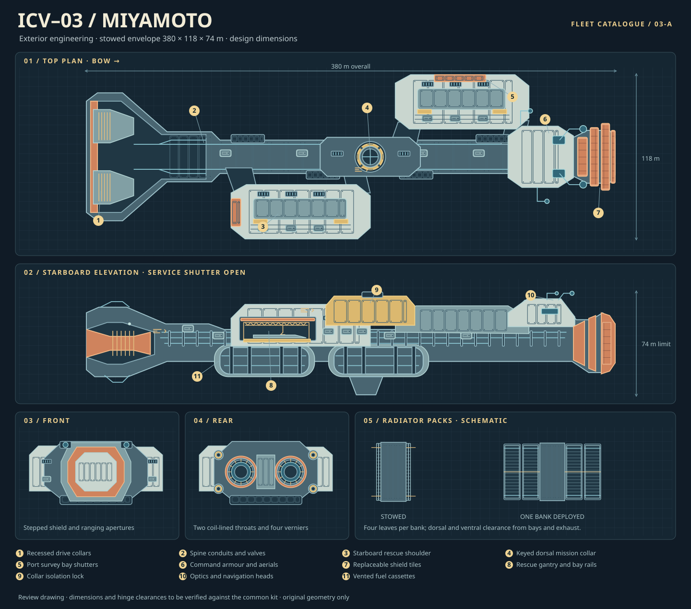

# Ship 03 — Waymark

**道標（みちしるべ） · Michishirube · Waymark** — literally a marker that shows the way. Keep the reading at first mention because the kanji have another reading. Language review passed; native-reader signoff pending.

**Design review draft, MODULES-402 / MODULES-405.** All dates, specifications and technologies below are fictional design targets. The ship is a fleet command and rescue vessel, designation **ICV-03**, fleet number **03**, classified as a Waymark-class expedition command vessel. Catalogue identifiers belong in the UI, never printed on the mesh.

## Service history

Designed in 2448 and commissioned in 2456 as the first command ship built to keep an expedition operating after a casualty. During a 2459 outer-system relay failure, Waymark switched off its main drive, kept navigation and medical power running on independent buses, and recovered crews through the forward hangar while the aft one handled repairs. That exercise led to separate airlocks and shutters for the hangars and the isolation of medical air and power from both bays.

## Layout and fleet identity

The vessel has a narrow, straight load-bearing spine and two rectangular hangar shoulders stepped along opposite sides: port ahead, starboard aft. The recessed space between them exposes the collar and service connections from above. The bow is a short, blunt shield assembly, with three staggered layers and separate navigation apertures. Two large nozzles are recessed in the tail, with four smaller verniers at the corners. The wingless hull reads as a command ship from above, rather than a scaled Explorer or a shortened Heavy Transport.

Use the fleet kit's standard collars, fasteners, panel seams, conduits, replaceable thermal panels, hatches and service access. Ceramic white marks protected volumes; muted orange marks removable shields and shutters; yellow appears in small areas around service access. Heat sinks and the load-bearing spine use dark metal. Use geometry and material blocks for wear and layering; keep the hull free of logos, flags and printed markings. Ship 01 should read as the slender survey vessel; Ship 02 has the large, repeated logistics modules and by far the largest envelope. Confirm the exact proportions, material identifiers and mounts against MODULES-407 and the two companion designs before modelling.

| Station from tail (+Y, m) | Part or compartment | Role and visibility |
| --- | --- | --- |
| 0–58 | Main drive and thrust frame | Two flush fusion-triggered nozzles at X ±22 m, Z 0; throat rings, field coils, feed manifolds and a blast bulkhead. Four smaller plasma verniers at the aft corners steer and dock; they cannot perform the interstellar braking burn. |
| 58–90 | Engineering and isolators | Reactor chambers, locked-out service corridor, two isolated auxiliary power units, emergency fission battery room and distribution breakers. Keep the propulsion and hotel loops separate. |
| 90–250 | Fuel and water shielding | Two port and two starboard tank barrels below deck, at X ±24 m and Z −12 m; sealed pressure compartments, individual isolation, and symmetric drawdown. Water jacket around hab spaces doubles as consumable reserve. |
| 104–204 | Starboard hangar | Aft-facing rescue bay door in the stepped shoulder; gantry, maintenance racks and a pressure vestibule. Keep a clear sortie corridor aft and laterally; no launches under thrust. |
| 174–234 | Mission collar | Removable command, relay or relief payload on a keyed dorsal collar with capped utilities. Exchange at a dock, with independent pressure and power isolation. |
| 222–318 | Port hangar | Forward shoulder, lateral bay opening; survey craft, drones, access bridge and emergency shutters. The two bays together carry two cutters and six drones. |
| 252–302 | Habitation and medical | Bunks and mess, a hydroponics rack, water and air recycling, and a six-bed triage bay with separate quarantine and transfer access. Crew decks stand perpendicular to thrust; restraints are used at low acceleration or during the flip. |
| 302–350 | Armoured command citadel | Operations ring around a communications core, local navigation desk, medical link and two escape passages. Remote cameras replace a large exposed bridge window. |
| 350–380 | Bow defence and navigation | Replaceable spaced shield tiles, retracted optical heads, steerable ranging apertures and two debris-intercept mounts. Side apertures give redundancy if the bow is damaged. |

The tank barrel budget is four clear cylinders, each 22 m internal diameter by 72 m long, or about 109,500 m³ total before domes. At a fictional stored density of 850 kg/m³, 84,000 t takes roughly 98,824 m³, about 90% of barrel volume. Nominal barrel intervals are 92–164 and 174–246 m. Stow radiators inside the envelope and keep deployed radiator planes outside hangar approach corridors and exhaust cones. Retract extended arrays for docking or debris exposure. Sustained main burn needs the full qualified radiator area; stowed radiators allow short transients only.

The cutaway should expose the pressure bulkheads, marked compartment groups (labels in UI), separate fuel and service corridors, door recesses, reactor isolation and interior bridge and bay fixtures. Put interior and removable shell pieces in separate model groups so the existing web component can show them independently. Geometry comes from number tables and the shared kit, then flows through the part registry and the same three.js scene, drawing and GLB paths. No separate model or texture asset is needed. Expose paired bays and removable equipment as named inspectable modules.

## Proposed specifications

| Item | Design target |
| --- | --- |
| Stowed envelope | 380 m long × 118 m wide × 74 m high (X = width, +Y = bow, Z = dorsal) |
| Mass, full mission load | 105,000 t: 21,000 t loaded inert mass plus 84,000 t propellant |
| Cargo | 2,800 t, already included in the 21,000 t loaded inert mass; relief and equipment containers, not additional fuel |
| Crew and passengers | 144 crew; 72 additional berths on an extended expedition, 180 short-duration evacuees for up to 30 days |
| Endurance | 32 years onboard at normal complement before depot overhaul, including the standard full-length transit |
| Main propulsion | Two fictional fusion-triggered directed-conversion drives; combined rated launch thrust 20.6 MN at 0.020 g sustained |
| Maximum acceleration | 0.050 g for up to 120 seconds (51.5 MN at loaded departure mass), available only with the thermal buffer charged; excluded from journey planning |
| Secondary propulsion | Four independent low-power plasma verniers for trim, docking and attitude control |
| Independent power | Two isolated 120 MW electrical auxiliary fusion plants; one 12 MW electrical fission emergency unit for essential command, medical and life support |
| Main thermal budget | Eight 25 × 60 m two-sided radiator leaves, 24,000 m² total emitting area; about 0.92 GW at 930 K and emissivity 0.90 before view-factor losses. 0.8 GW effective heat-rejection budget. |
| Operational velocity | 0.300 c maximum peak for a symmetric accelerate/flip/brake profile; no cruise leg in this mode |
| Theoretical velocity | 0.311 c ideal midpoint, starting loaded and finishing at rest with protected reserve; not permitted by the shield limit |
| Estimated interstellar range | 4.68 light-years per standard 0.020 g start-to-stop burn at the 0.300 c qualification limit. A lower-acceleration profile may extend this range, subject to the 32-year onboard endurance limit and the same propellant reserve. |

## Propulsion, journey calculation and limits

**Fictional mechanism.** Fusion powers and triggers an invented directed conversion process: the propellant stream leaves through magnetically isolated nozzles with an effective exhaust speed of 0.45 c. Ordinary fusion cannot deliver the required specific energy or power density. At 0.020 g and full departure mass the exhaust carries roughly 1.47 PW of kinetic power; getting that exhaust from a stored mass stream at 0.45 c requires converting about 10.7% of the expelled mass-energy to directed kinetic energy. Confinement and extraordinary isolation are both fictional assumptions, not claims about achievable engineering. No more than 0.8 GW may reach the ship as drive and hotel waste heat; even a small coupling fault overwhelms the radiators and aborts the burn. The hotel power plants cannot substitute for the main drive. Reserves cannot make up for the loss of both main engines.

Use an inertial endpoint frame and idealize each leg as constant proper acceleration of magnitude a. At halfway by distance the ship flips; the other half applies the same proper acceleration against the velocity. Endpoints are at rest in the same frame. No instantaneous velocity change at the flip. The numerical model neglects finite flip time, tides and transfers; real mission schedules in the fiction add allowance. Do not insert a cruise segment or silently clamp the computed velocity: if the planned peak exceeds the cap, recompute at a permitted acceleration and check time and propellant.

For length D and speed of light c, midpoint rapidity η = acosh(1 + aD / (2c²)). Peak v = c tanh(η), onboard duration = 2cη/a, endpoint-frame duration = 2c sinh(η)/a. The ideal directed-exhaust mass ratio is exp(2η / 0.45); book 4,200 t of propellant as protected reserve. For a 4.37 light-year test route at 0.020 g: **0.29063 c** peak, **28.989 years aboard**, **29.424 years in the endpoint frame**. Ideal arrival mass is about 27,770 t, retaining 6,770 t of propellant including the 4,200 t reserve. At the shield cap the burn still reaches rest above the protected reserve. The theoretical 0.311 c midpoint uses the full burn allowance above that reserve. Derived values use c = 299,792,458 m/s and the Julian year (31,557,600 s); confirm the same implementation against MODULES-395 before wiring the journey card.

The bow stack handles diffuse particles in acceleration. During braking the stern faces the velocity vector, so a spaced stern shield surrounds the nozzle openings and active clearing protects their open corridors; do not assume the bow still leads. Optical elements and rescue doors stay shut through the burn. No shield certifies survival against a large untracked object. Hold pre-surveyed corridors, carry a stop-to-rest fuel allowance, and suspend manoeuvres or thrust on loss of attitude, shield, feed, or radiator margin. Strengths: independent command/medical systems, protected navigation, two separately usable bays. Weaknesses: moderate acceleration, limited payload for the volume, high thermal sensitivity and long exposure to route hazards.

## Influence and originality check

The references were reviewed as a group. Use their visible assembly seams, functional layers, colour blocking and multiple orthographic views; no image assets enter this design.

| Influence | Principle used | Originality check |
| --- | --- | --- |
| Real aerospace manufacturing | Accessible connectors, replaceable shielding, dedicated thermal loops and service breaks | No real vehicle outlines, insignia or markings. |
| Japanese space anime | Large readable masses and integrated engines, with mechanical detail where hardware is serviced | No nautical prow, tall bridge tower, atmospheric wing or transforming feature. |
| Star Trek design tradition | Redundant navigation and mission systems; inspectable interior compartments | Compared with the closest compact armoured reference (Defiant): Waymark has a long uninterrupted spine and longitudinally staggered rectangular shoulders, no rounded blended wedge, outrider nacelles or borrowed deck plan. |
| Star Wars industrial tradition | Recessed hangars, layered plating and a visible thrust frame | Compared with the reference capital carrier (Venator): Waymark has no triangular plan, split bridge towers, dorsal runway or copied bay arrangement. |

The diagram is an original design review sketch, not a rendered 3D screenshot or dimensioned manufacturing drawing. Approval of MODULES-402 and the landed shared kit are prerequisites for the 3D build, inspection modes and the six screenshot views.
