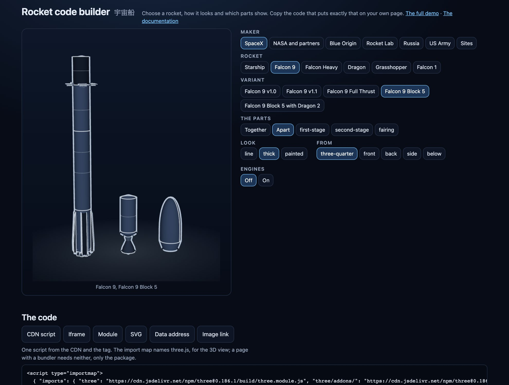

Every part of every rocket has the same record: its real size in metres, the joints it mates at and where its shape came from. That is why you can ask whether a rocket goes together before you draw anything.

## One record for every part

A part's origin is the middle of its base on its axis, Y is up and the windward side faces +Z. A joint says where the part mates and how wide it is there.

```ts
import { partEntry } from "@johnmorrisdotca/uchusen-rockets";

const ship = partEntry("starship-v3-ship")?.record;
console.log(ship?.name, ship?.height, "m", ship?.kind);
console.log(ship?.joints.bottom, ship?.trueTo);
console.log(ship?.drawnFrom);
```

`trueTo` lists the variants the part is true for. A part with an empty list was never part of a flown or announced vehicle.

## Ask whether it fits

`check` reads only the records, so it runs anywhere and is cheap enough for a form to ask on every change.

```ts
import { check } from "@johnmorrisdotca/uchusen-rockets";

const real = check({ rocket: "starship", variant: "v3" });
console.log(real.ok, real.custom, real.label, real.size);

const mix = check({ rocket: "starship", variant: "v3", parts: { ship: "starship-v2-ship" } });
console.log(mix.ok, mix.custom, mix.label);

const wrong = check({ rocket: "starship", variant: "v3", parts: { booster: "starship-v3-ship" } });
console.log(wrong.ok, wrong.issues[0]?.code, wrong.issues[0]?.message);
```

A mix that fits is **allowed** and is labelled as a custom build in plain words. It is never called a vehicle that flew. A part that does not fit is refused by name, and the report says which joint failed: the kind, the diameter or the slot.

## Show a custom build on a page

In HTML the `build` attribute is the description as JSON. In React the `build` prop is the object.

```html
<uchusen-rocket build='{"rocket":"starship","variant":"v3","parts":{"ship":"starship-v2-ship"}}' look="thick"></uchusen-rocket>
```

## A mesh and a drawing, with no three.js

`build` from the `build` entry makes the `.glb` file's bytes and a drawing from one description. It works in Node and in a browser and imports neither three.js nor the DOM. It throws `FitError` when the description does not fit.

```ts
import { build, FitError } from "@johnmorrisdotca/uchusen-rockets/build";

const rocket = build({ rocket: "starship", variant: "v3" });
console.log(rocket.shows.join(", "));
console.log(rocket.glb().bytes.length > 1000, rocket.svg({ look: "thick", view: "below", show: "booster" }).startsWith("<svg"));

try {
  build({ rocket: "starship", variant: "v3", parts: { booster: "starship-v3-ship" } });
} catch (error) {
  console.log(error instanceof FitError);
}
```

`rocket.parts` holds each part's mesh and bounds, `rocket.placesOf(show)` says where each stands and `rocket.boundsOf(show)` how big the picture is. `rocket.fitWidthOf(show)` is the width, in metres, that the default fit holds when a part names one, or `null` when the fit holds all of it: a craft with long thin arrays or booms can name one so its body is not drawn small, and the outer parts then run off the frame's edge. No built-in craft does, so each is shown whole. The drawing and the 3D view frame the same box.

## A part on its own

```ts
import { buildPart } from "@johnmorrisdotca/uchusen-rockets/build";

const raptor = buildPart("raptor-vacuum");
console.log(raptor.record.kind, raptor.glb().bytes.length < 600_000);
```

## Let a reader build one

`builderState` is the rule behind the demo's builder. It lists rows from the bottom up, each offering only what fits on the row below. A row with one answer is answered for the reader, and a change lower down keeps what still fits. So the builder can never reach a rocket that does not go together, and `check` still has the last word.

```ts
import { builderState } from "@johnmorrisdotca/uchusen-rockets";

const start = builderState();
console.log(start.rows.map((row) => `${row.label}: ${row.options.length} offered`));
const picked = builderState([start.rows[0]?.options[1]?.id ?? ""]);
console.log(picked.description, picked.report.ok);
```



The [live builder](https://johnmorrisdotca.github.io/uchusen-rockets/builder.html) is this, with a preview and the code to copy. See [Architecture](architecture.md) for how a part is a table of numbers.
