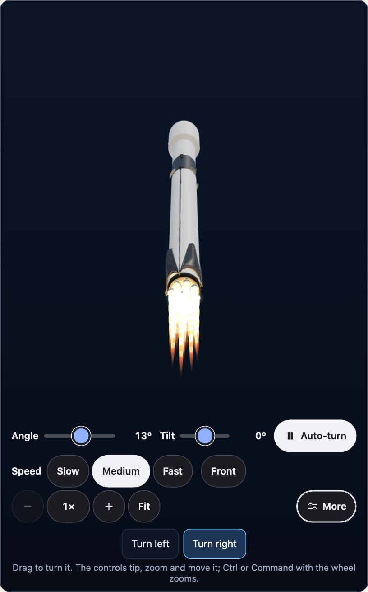
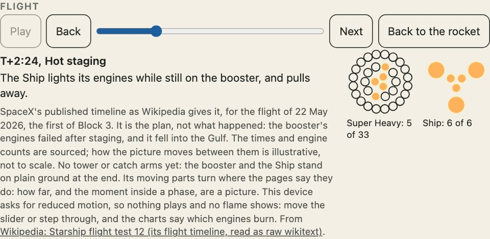

`engines="on"` lights every engine that shows, at full thrust. A flight plays a rocket through its phases with only the engines that burn in each one.



## Light the engines

```html
<uchusen-rocket rocket="falcon-9" variant="block-5" look="painted" engines="on"></uchusen-rocket>
```

A painted rocket gets a flame with shock diamonds and a glow on the hull; the line looks get a drawn flame and a ring. An engine lights only where a source tells of it and the drawing has it, so a part with neither, or a stage that has landed, has no flame. A reader who asked for reduced motion has the engines off whatever the page says.

```ts
import { enginesWanted } from "@johnmorrisdotca/uchusen-rockets";

console.log(enginesWanted("on", false), enginesWanted("on", true), enginesWanted("maybe", false));
```

## Which engines burn

The count of burning engines comes from a source. Which ones is a rule: from the middle outwards, and a ring that is only partly used has them spread evenly round it.

```ts
import { build } from "@johnmorrisdotca/uchusen-rockets/build";
import { bellsOf, pickBells, ringsOf } from "@johnmorrisdotca/uchusen-rockets";

const booster = build({ rocket: "falcon-9", variant: "block-5" }).parts[0];
if (booster) {
  const bells = bellsOf(booster.pieces);
  console.log(bells.length, ringsOf(bells).map((ring) => ring.length), pickBells(bells, 3).length);
}
```

## Play a flight

`<uchusen-flight for="rocket">` is a play button, a slider, Back and Next, a line saying where the flight is and what happens there, and a chart of each part's engines from below with the burning ones filled.

```html
<uchusen-rocket id="rocket" rocket="falcon-9" variant="block-5" look="painted"></uchusen-rocket>
<uchusen-flight for="rocket"></uchusen-flight>
```



A variant has a flight only where a page gives one: Starship's first, fifth, seventh and twelfth flight tests, Falcon 9 v1.0 with Dragon 1 and Dragon 1 on its own (COTS Demo Flight 1), Falcon 9 v1.1, Full Thrust and Block 5 (with and without Dragon 2), Falcon Heavy and Grasshopper's highest hop. The other variants say so, and a custom build never has one. A phase shows an altitude or a speed only where its page gives one, in the page's words.

The flight bar says its own words (Play, Back, Next and the rest) in English. To say them in another language, set `words` on the element: `flight.words = { play: "Start", pause: "Stop" }`. What is left out stays English, and a phase's name, what happens in it and a flight's note are the data's and stay as they are.

Grid fins, legs and flaps turn in a flight where the pages say they do (the Falcon 9's grid fins stowed on ascent and open for the entry, its legs open before the touchdown, Super Heavy's fins steering after the boostback, the Ship's flaps at its entry). How far they turn is a picture, and a painted model that is one shell does not turn: nothing is cut to fake a move.

## A flight as data

```ts
import { burnsOf, clockWords, flightOf, phasePosition } from "@johnmorrisdotca/uchusen-rockets";

const flight = flightOf("starship", "v3");
if (flight) {
  console.log(flight.name, "-", flight.basis);
  const at = phasePosition(flight, "hot-staging");
  const phase = at === null ? undefined : flight.phases[Math.round(at)];
  if (phase) console.log(phase.name, clockWords(phase.at), burnsOf(phase));
}
console.log(flightOf("starship", "v4"));
```

`flightOf` gives `null` for a variant with no flight. Each flight says whose timing it is and whether it was the plan or what happened (`flight.basis`).

## From a script

`element.flight`, `element.play()`, `element.pause()`, `element.seek(position)` and `element.endFlight()` move it; `element.flightState` says where it is. `FlightClock` is the same clock without the element: it moves only when told to, once a frame by whoever draws.

```ts
import { FlightClock, flightOf, lastPosition } from "@johnmorrisdotca/uchusen-rockets";

const flight = flightOf("falcon-9", "block-5");
if (flight) {
  const clock = new FlightClock(flight);
  clock.play();
  clock.advance(2.4);
  console.log(clock.position, lastPosition(flight), clock.ended);
}
```

## A flame's colour

A flame is drawn in the colours of what its engine burns, and the engine's propellant is a figure with its page: `PROPELLANTS` lists each engine whose propellant a page read here names, and `propellantOf(rocket, engineText)` finds it from the engine text of a variant. A kerosene flame (Merlin, Kestrel, F-1, Rutherford, RD-107 and RD-108) is orange, a methane flame (Raptor, BE-4) bluish, a hydrogen flame (J-2, RS-25, BE-3) pale blue and almost white, a solid motor's (the Space Shuttle's boosters and the SLS's) a brighter orange, and the lunar module's descent engine, which burns Aerozine 50 and nitrogen tetroxide, a faint pale one. An engine no page read here names, such as the ship of the 2019 design, whose data counts its engines and names none, has a neutral grey-white flame: a colour is never a guess. The colours themselves are a picture, as a flame's length is.

```ts
import { propellantOf } from "@johnmorrisdotca/uchusen-rockets";

const raptor = propellantOf("starship", "33 Raptor 3");
console.log(raptor?.propellant.value, raptor?.propellant.source, raptor?.flame);
console.log(propellantOf("starship", "3 sea-level and 3 vacuum"));
```

## Sourced, and only a picture

| Sourced | Illustrative |
| --- | --- |
| When each phase comes and how many engines burn, each from a named page. | Where the parts stand, how fast the flight plays (2.4 seconds a phase), the ground falling away, smoke, and a flame's length and colour. |

A blank is a blank: a phase with no time says so, and a flame drawn with no count says how many are drawn and that no page says.

## What it costs the machine

A flight has no clock of its own: it moves inside the view's one frame loop. It stands still out of sight and ends by itself. A flame flickers at most 30 times a second and stops moving after 15 seconds with nobody touching anything (`FLAME_SETTLE_MS`). Lighting and dousing engines makes and frees nothing on the graphics card after the first flame.

## Lights

The Lights tab is on every craft. A fleet ship offers Off, Running only and All. A craft whose lights are not drawn yet offers only Off and says so.
