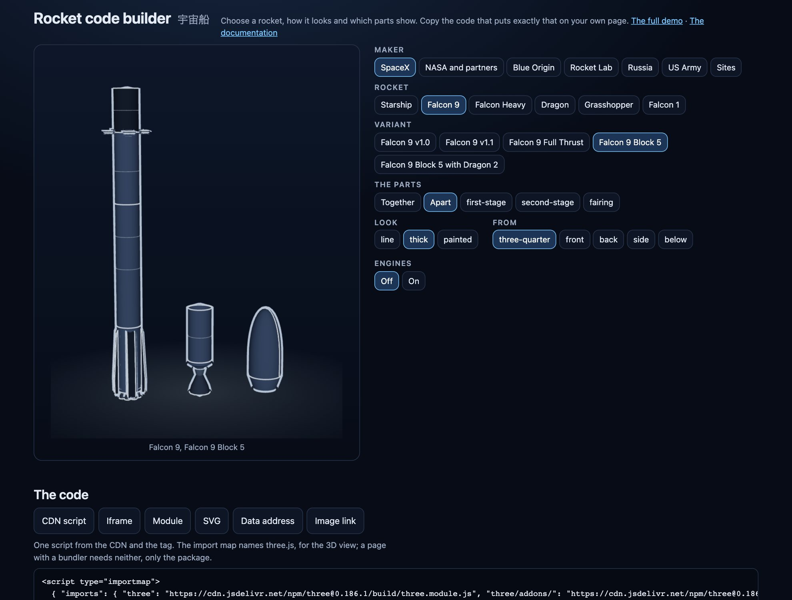

どのロケットのどの部品も、同じ形式のレコードを持ちます。実寸（メートル）、接合部、形状の出典です。だから、何かを描く前に、ロケットが組み合わさるかを尋ねられます。

## すべての部品に同じレコード

部品の原点は底の中心で軸上にあり、Y が上、風上側が +Z を向きます。接合部は、その部品がどこで組み合わさり、そこでどれだけの幅かを示します。

```ts
import { partEntry } from "@johnmorrisdotca/uchusen-rockets";

const ship = partEntry("starship-v3-ship")?.record;
console.log(ship?.name, ship?.height, "m", ship?.kind);
console.log(ship?.joints.bottom, ship?.trueTo);
console.log(ship?.drawnFrom);
```

`trueTo` は、その部品が対応する型式の一覧です。一覧が空の部品は、飛んだ機体にも発表された機体にも使われたことがありません。

## 組み合わさるかを尋ねる

`check` はレコードだけを読むので、どこでも動き、フォームが変更のたびに呼び出しても軽く済みます。

```ts
import { check } from "@johnmorrisdotca/uchusen-rockets";

const real = check({ rocket: "starship", variant: "v3" });
console.log(real.ok, real.custom, real.label, real.size);

const mix = check({ rocket: "starship", variant: "v3", parts: { ship: "starship-v2-ship" } });
console.log(mix.ok, mix.custom, mix.label);

const wrong = check({ rocket: "starship", variant: "v3", parts: { booster: "starship-v3-ship" } });
console.log(wrong.ok, wrong.issues[0]?.code, wrong.issues[0]?.message);
```

成り立つ組み合わせは**許可**され、わかりやすい言葉で「カスタム構成」と表示されます。実際に飛んだ機体と呼ばれることはありません。成り立たない部品は名前を挙げて拒否され、レポートにはどの接合部が合わなかったか（種類、直径、スロット）が書かれます。

## カスタム構成をページに出す

HTML では、`build` 属性が JSON の記述です。React では、`build` prop がオブジェクトです。

```html
<uchusen-rocket build='{"rocket":"starship","variant":"v3","parts":{"ship":"starship-v2-ship"}}' look="thick"></uchusen-rocket>
```

## three.js なしでメッシュと図面を作る

`build` エントリーの `build` は、ひとつの記述から `.glb` ファイルのバイト列と図面を作ります。Node でもブラウザーでも動き、three.js も DOM も読み込みません。記述の部品が組み合わさらないと `FitError` を投げます。

```ts
import { build, FitError } from "@johnmorrisdotca/uchusen-rockets/build";

const rocket = build({ rocket: "starship", variant: "v3" });
console.log(rocket.shows.join(", "));
console.log(rocket.glb().bytes.length > 1000, rocket.svg({ look: "thick", view: "below", show: "booster" }).startsWith("<svg"));

try {
  build({ rocket: "starship", variant: "v3", parts: { booster: "starship-v3-ship" } });
} catch (error) {
  console.log(error instanceof FitError);
}
```

`rocket.parts` は各部品のメッシュと境界を持ち、`rocket.placesOf(show)` は各部品の位置を、`rocket.boundsOf(show)` は図の大きさ（境界）を返します。

## 部品ひとつだけ

```ts
import { buildPart } from "@johnmorrisdotca/uchusen-rockets/build";

const raptor = buildPart("raptor-vacuum");
console.log(raptor.record.kind, raptor.glb().bytes.length < 600_000);
```

## 閲覧者に組み立ててもらう

`builderState` は、デモのビルダーの背後にある規則です。下から順に行を並べ、各行はその下の行に合うものだけを出します。答えがひとつしかない行は自動で決まり、下の行を変えても、まだ合うものは残ります。そのため、ビルダーは組み合わさらないロケットには決してたどり着けません。それでも最終的な判定は `check` が行います。

```ts
import { builderState } from "@johnmorrisdotca/uchusen-rockets";

const start = builderState();
console.log(start.rows.map((row) => `${row.label}: ${row.options.length} offered`));
const picked = builderState([start.rows[0]?.options[1]?.id ?? ""]);
console.log(picked.description, picked.report.ok);
```



[ライブのビルダー](https://johnmorrisdotca.github.io/uchusen-rockets/builder.html)はこの仕組みに、プレビューとコピーできるコードを加えたものです。部品が数値の表であることは、[設計](architecture.md)を参照してください。
