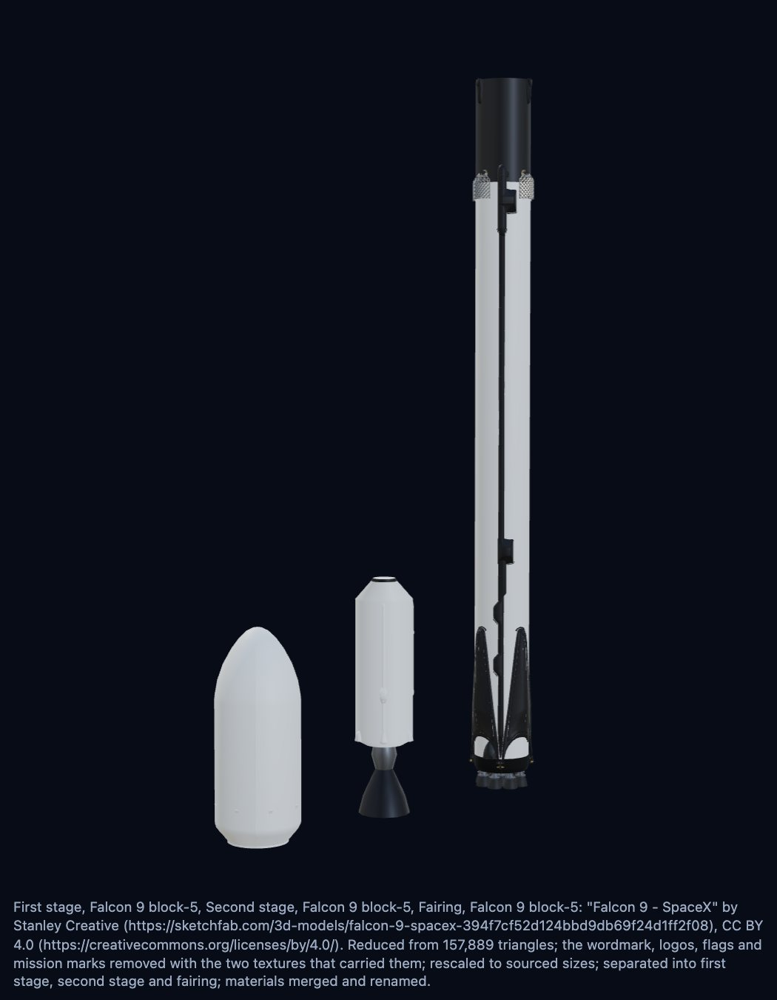

図面は使われるために作られています。自分のページにも、デモと同じロケットを6通りのどの方法でも載せられます。デモには、画面に出ているものを載せるコードをコピーできるパネル（ファミリー共通の埋め込みパネル）があります。6通りに加えて React、Vue、Angular、Svelte のタブ、大きさ、コードの横の図面、埋め込みページを開く、ドキュメントを読む、SVG と PNG の保存があります。



| 方法 | 使う場面 |
| --- | --- |
| `element` | ページでスクリプトを実行できるとき。スクリプトタグ1つ、three.js のインポートマップ、そして要素のタグ。 |
| `iframe` | ページでスクリプトを実行できないとき。埋め込みページの iframe。 |
| `module` | 自分のスクリプトから SVG を受け取りたいとき。 |
| `svg` | 図面そのものがほしいとき。 |
| `data` | 自分のファイルなしで `` に入れたいとき。 |
| `link` | パッケージ内のファイルを指す普通の ``。斜め前からの視点で、炎なし。 |

## コードを生成する

`embedCode(options, kind, settings)` がスニペットを生成します。`settings.size` で、iframe の最大の幅とリンク先の画像の幅を決めます（初期値は 480）。

```ts
import { EMBED_KINDS, embedCode } from "@johnmorrisdotca/uchusen-rockets";

const options = { rocket: "starship", variant: "v3", look: "line", view: "three-quarter" };
for (const kind of EMBED_KINDS) console.log(kind.padEnd(8), embedCode(options, kind).slice(0, 70).replaceAll("\n", " "));
```

## 埋め込みページ

スクリプトを実行できないページ向けに、URL の指定どおりに描く `embed.html` の iframe があります。クエリは要素の属性と同じで、`rocketToParams` と `rocketFromParams` がオプションとクエリを相互に変換します。

```html
<!doctype html>
<html lang="en">
  <head>
    <meta charset="utf-8" />
    <meta name="viewport" content="width=device-width, initial-scale=1" />
    <title>Uchusen Rockets in an iframe</title>
  </head>
  <body>
    <iframe
      src="https://johnmorrisdotca.github.io/uchusen-rockets/embed.html?rocket=starship&variant=v3&look=line"
      title="Starship Block 3"
      style="width: 100%; max-width: 480px; aspect-ratio: 3 / 4; border: 0"
      loading="lazy"
    ></iframe>
  </body>
</html>
```

```ts
import { rocketFromParams, rocketToParams } from "@johnmorrisdotca/uchusen-rockets";

const query = rocketToParams({ rocket: "falcon-9", variant: "block-5", show: "apart" });
console.log(query.toString(), rocketFromParams(query));
```

埋め込みは、まず線画を表示し、ブラウザーが描けるなら3Dビューを出します。彩色モデルが読み込まれるのは URL に `look=painted` があるときだけで、読み込み先は常にサイト自身です。自分でコピーを置くなら、`embedCode` の第3引数 `{ site, cdn }` でコードの宛先を変えられます。

## クレジットは彩色したロケットについていく

彩色モデルは CC BY 4.0 のままであるか、該当の行にそう書かれていればパブリックドメインです。`embedCode` は `check` に、どの部品が表示されているかを尋ね、その部品のクレジットを、彩色したすべての出力形式（要素のキャプション、iframe のキャプション、モジュール、SVG の説明、data URL）に書き込みます。

```ts
import { paintedCredit } from "@johnmorrisdotca/uchusen-rockets";

console.log(paintedCredit({ rocket: "starship", variant: "v3", look: "painted" }));
console.log(JSON.stringify(paintedCredit({ rocket: "starship", variant: "v3", look: "line" })));
```

線画にはそのようなクレジットはなく、このパッケージ自身が塗る型式にもありません。部品ひとつだけを表示したロケットは、その部品のクレジットだけを付けます。デモから画像を保存するときは、ファイルと一緒に、表示されたクレジットを保管してください。

## スクリプトなしの画像

`assetPathOf` は、オプションに対応する同梱の図面を、パッケージの `dist/assets/` の中のパスとして返します。バンドラーや CDN がそのまま配信できます。

```ts
import { assetPathOf, CDN } from "@johnmorrisdotca/uchusen-rockets";

console.log(assetPathOf({ rocket: "starship", variant: "v3" }), assetPathOf({ rocket: "starship", variant: "v3", look: "painted", view: "below" }));
console.log(CDN);
```

`null` は、そのオプションに対応するファイルが同梱されていないという意味です。その場合は、どんな組み合わせでも描ける要素かモジュールを使ってください。
