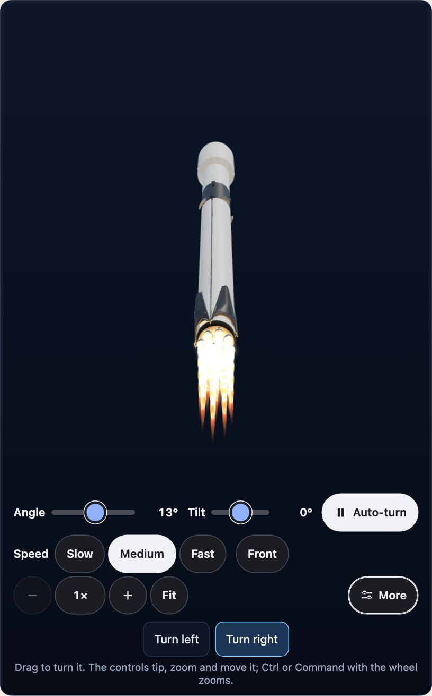
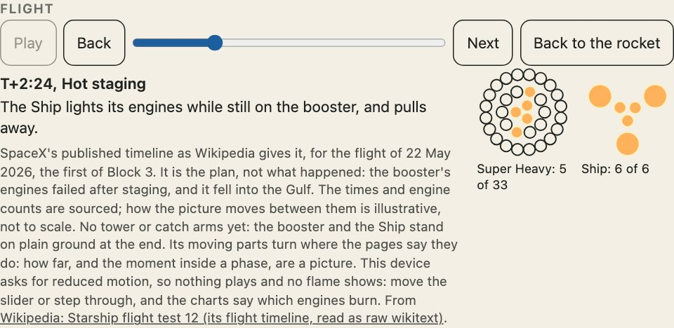

`engines="on"` は、見えているすべてのエンジンを全推力で点火します。飛行は、ロケットをフェーズごとに進め、そのフェーズで燃えているエンジンだけを点火します。



## エンジンを点火する

```html
<uchusen-rocket rocket="falcon-9" variant="block-5" look="painted" engines="on"></uchusen-rocket>
```

彩色のロケットには、ショックダイヤモンドのある炎と機体表面の発光が付き、線画の見た目には描かれた炎とリングが付きます。エンジンが点火するのは、出典がそれを伝え、図にもそのエンジンがある場合だけです。どちらかがない部品や、着陸済みの段には炎がありません。動きを減らす設定を選んだ閲覧者には、ページの指定にかかわらずエンジンは消えています。

```ts
import { enginesWanted } from "@johnmorrisdotca/uchusen-rockets";

console.log(enginesWanted("on", false), enginesWanted("on", true), enginesWanted("maybe", false));
```

## どのエンジンが燃えるか

燃えているエンジンの数は出典で決まります。どれが燃えるかは規則で決まり、中心から外側へ順に選び、一部だけ使うリングでは、リングに沿って均等に配置します。

```ts
import { build } from "@johnmorrisdotca/uchusen-rockets/build";
import { bellsOf, pickBells, ringsOf } from "@johnmorrisdotca/uchusen-rockets";

const booster = build({ rocket: "falcon-9", variant: "block-5" }).parts[0];
if (booster) {
  const bells = bellsOf(booster.pieces);
  console.log(bells.length, ringsOf(bells).map((ring) => ring.length), pickBells(bells, 3).length);
}
```

## 飛行を再生する

`<uchusen-flight for="rocket">` は、再生ボタン、スライダー、戻る・次へのボタン、飛行のどこで何が起きているかを示す一行、そして各部品のエンジンを下から見たチャート（燃えているものは塗りつぶし）です。

```html
<uchusen-rocket id="rocket" rocket="falcon-9" variant="block-5" look="painted"></uchusen-rocket>
<uchusen-flight for="rocket"></uchusen-flight>
```



飛行が用意されているのは、出典ページがタイムラインを示している型式だけです。スターシップの飛行試験1・5・7・12、ファルコン9のv1.0（ドラゴン1つき）とドラゴン1だけ（COTSデモ飛行1）、ファルコン9のv1.1・フルスラスト・ブロック5（ドラゴン2つきとなし）、ファルコン・ヘビー、グラスホッパーのいちばん高い跳躍があります。ほかの型式はその旨を表示し、カスタム構成には飛行がありません。高度や速度は、そのページが示しているときだけ、ページの言葉のまま表示されます。

飛行バー自身の言葉（再生、戻る、次へなど）は英語です。ほかの言語にするには、要素の `words` を設定します（`flight.words = { play: "再生", pause: "一時停止" }`）。書かなかった言葉は英語のままです。各段階の名前、その内容、飛行の注はデータのものなので、そのまま表示されます。

グリッドフィン・脚・フラップは、ページが動くと書いている場面で飛行中に動きます（ファルコン9のグリッドフィンは上昇中は畳まれて再突入で開き、脚は着地の前に開きます。スーパーヘビーのフィンはブーストバックの後に針路を少し直し、船体のフラップは再突入で動きます）。どれだけ動くかは絵であり、ひとつの殻でできた彩色モデルは動きません。動きを偽るために切り分けることはありません。

## データとしての飛行

```ts
import { burnsOf, clockWords, flightOf, phasePosition } from "@johnmorrisdotca/uchusen-rockets";

const flight = flightOf("starship", "v3");
if (flight) {
  console.log(flight.name, "-", flight.basis);
  const at = phasePosition(flight, "hot-staging");
  const phase = at === null ? undefined : flight.phases[Math.round(at)];
  if (phase) console.log(phase.name, clockWords(phase.at), burnsOf(phase));
}
console.log(flightOf("starship", "v4"));
```

飛行がない型式には `flightOf` が `null` を返します。各飛行には、誰が示したタイミングか、計画なのか実際に起きたことなのか（`flight.basis`）が記されています。

## スクリプトから

`element.flight`、`element.play()`、`element.pause()`、`element.seek(position)`、`element.endFlight()` で動かし、`element.flightState` で今どこまで進んだかがわかります。`FlightClock` は要素なしの同じ時計で、描く側から1フレームごとに呼ばれたときだけ進みます。

```ts
import { FlightClock, flightOf, lastPosition } from "@johnmorrisdotca/uchusen-rockets";

const flight = flightOf("falcon-9", "block-5");
if (flight) {
  const clock = new FlightClock(flight);
  clock.play();
  clock.advance(2.4);
  console.log(clock.position, lastPosition(flight), clock.ended);
}
```

## 炎の色

炎は、そのエンジンが燃やすものの色で描かれます。エンジンの推進剤は出典つきの数値で、`PROPELLANTS` は、ここで読んだページが推進剤を挙げているエンジンを一覧にし、`propellantOf(rocket, engineText)` は型式のエンジンの文章からそれを探します。ケロシンの炎（Merlin、Kestrel、F-1、Rutherford、RD-107、RD-108）はオレンジ、メタンの炎（Raptor、BE-4）は青みがかった色、水素の炎（J-2、RS-25、BE-3）は白に近い淡い青、固体燃料の炎（スペースシャトルと SLS のブースター）はより明るいオレンジ、月着陸船の下降エンジン（エアロジン50と四酸化二窒素を燃やす）はごく淡い色です。ここで読んだページが挙げていないエンジン（たとえば、エンジンの数だけを書いて名前を書いていない2019年設計の宇宙船）は、灰色がかった白の炎で描かれます。色を推測で決めることはありません。色そのものは、炎の長さと同じく絵であり、測った値ではありません。

```ts
import { propellantOf } from "@johnmorrisdotca/uchusen-rockets";

const raptor = propellantOf("starship", "33 Raptor 3");
console.log(raptor?.propellant.value, raptor?.propellant.source, raptor?.flame);
console.log(propellantOf("starship", "3 sea-level and 3 vacuum"));
```

## 出典があるものと、見た目だけのもの

| 出典あり | 見た目だけ（出典なし） |
| --- | --- |
| 各フェーズがいつ来るか、何基のエンジンが燃えるか。それぞれ出典として名前を挙げたページから。 | 部品の立ち位置、再生の速さ（1フェーズ2.4秒）、遠ざかる地面、煙、炎の長さと色。 |

空欄は空欄のままです。時刻のないフェーズはそう表示し、基数のない炎は、何基描いたか、そしてどのページも基数を示していないことを表示します。

## マシンへの負荷

飛行は自分の時計を持たず、ビューのひとつのフレームループの中で動きます。画面外では止まり、最後まで来ると自動で終了します。炎は1秒に最大30回までちらつき、操作がないまま15秒たつと動きを止めます（`FLAME_SETTLE_MS`）。最初の炎のあとは、エンジンを点けても消しても、GPU 上のリソースを新たに作ることも解放することもありません。

## ライト

ライトのタブは、すべての機体にあります。SPXフリートの船は「オフ」「航行灯のみ」「すべて」を選べます。ライトをまだ描いていない機体は、「オフ」だけを選べて、まだ描いていないことを表示します。
