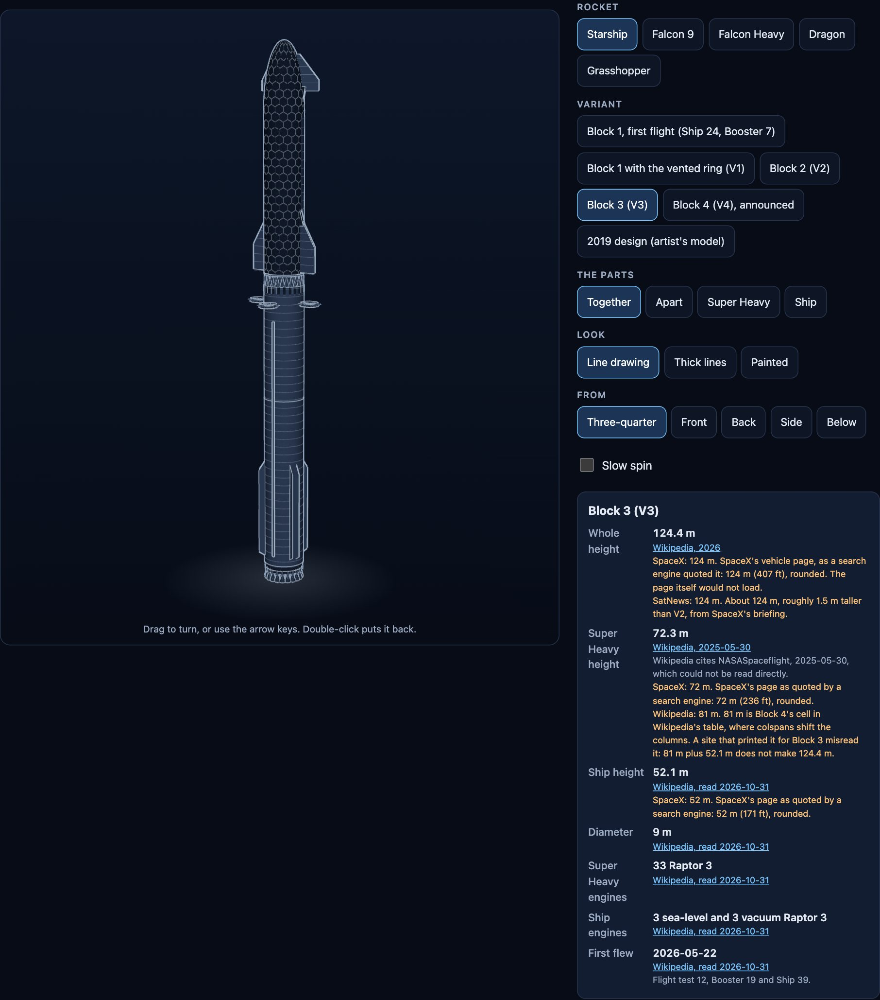
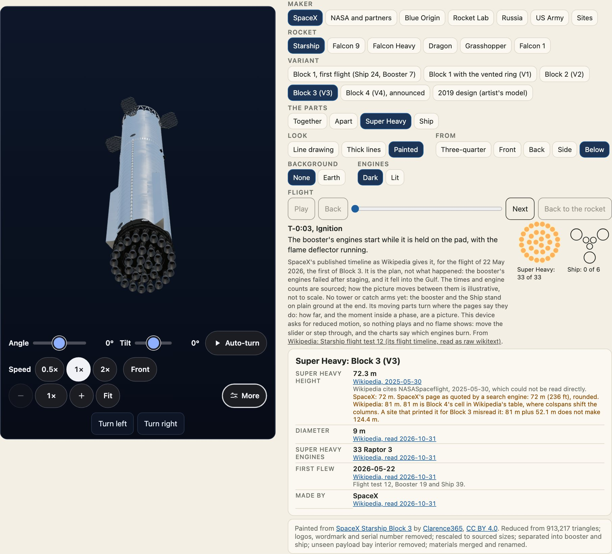
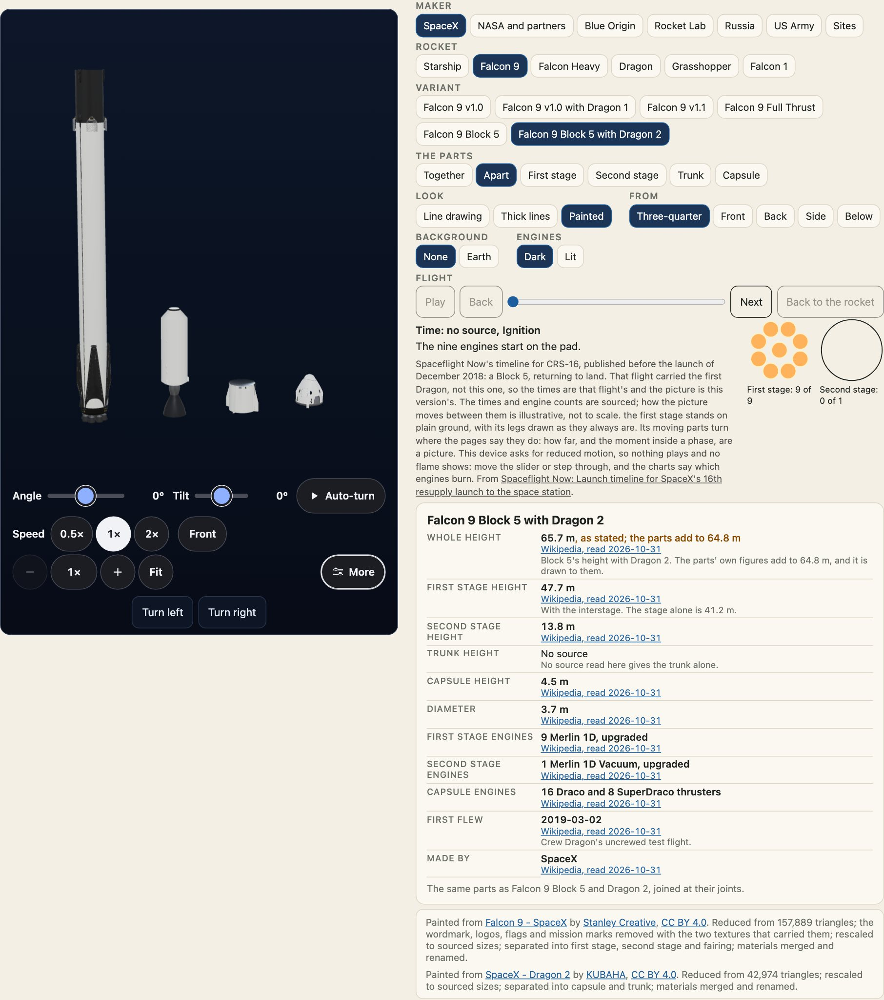

見え方を変える選択は3つあり、互いに独立しています。**見た目**（`look`、どう描くか）、**視点**（`view`、どちらから見るか）、**表示**（`show`、どの部品を出すか）です。どの見た目も、すべての型式で、組み上げた状態でも分解した状態でも、部品ひとつだけでも使えます。



## 見た目

| `look` | 内容 |
| --- | --- |
| `line` | 濃紺に細く明るい線。既定です。 |
| `thick` | 同じ図を太い線で描いたもの。小さいサイズや印刷向けです。 |
| `painted` | 素材と光。ライセンスつきのモデルがあればそれを、なければこのパッケージ自身の塗りを使います。 |

見た目を変えても角度は保たれます。変わるのは素材であり、カメラではありません。見た目は表（`LOOKS`）の1項目で、線・色・塗りを変えますが、形は決して変えません。

```ts
import { LOOKS, LOOK_NAMES, cleanLook } from "@johnmorrisdotca/uchusen-rockets";

console.log(LOOK_NAMES, LOOKS.thick.outline, cleanLook("glossy"));
```

`cleanLook` は外部から渡された値を見た目の名前にし、未知の値は既定にします。`cleanView` と `cleanShow` も同じで、綴りを間違えた属性や悪意のある属性は、既定の表示になるだけです。

宇宙にある機体は、実際の宇宙と同じ光で照らせます。`sun="1, 0.2, -0.5"` には、機体から見た太陽の向きを三つの数で書きます。すると、その向きから光が一つだけ当たり、反対側は暗く、ほかの光はほとんど入りません。書かなければ、ショールームのような明かりのままです。`parseSun` がこの属性を読みます。三つの数でない値は、太陽なしとして扱います。

## 視点



`view` は `three-quarter`（既定）、`front`、`back`、`side`、`below` です。**正面は風上のタイルの面、背面は鋼の面です。** それぞれの名前は角度です。

```ts
import { VIEWS, VIEW_NAMES, directionOf } from "@johnmorrisdotca/uchusen-rockets";

for (const name of VIEW_NAMES) console.log(name, VIEWS[name], directionOf(VIEWS[name]).map((n) => n.toFixed(2)).join(" "));
```

ドラッグすると選んだ角度から回り、矢印キーで少し動き、ビューの上でのホイール、ピンチ、`+` と `-` で拡大縮小し、Home かダブルクリックで元に戻ります。`spin` は自転の速さで、`off`、`slow`、`medium`、`fast`、または1周の秒数を指定します。`way` は `cw` か `ccw` です。ファミリー共通の表示コントロールを使うときは、回転はコントロール側が受け持ちます。速さは 0.5×、1×、2× のボタンで選び、コントロールが動かしている間、`spin` は止まります。

## デモの拡大表示とワイド

デモの表示バーでは、マイナスとプラスのボタンのあいだに拡大率（1×、2.4×、19×）が出ます。ボタン、ホイール、ピンチのどれで変えても同じように変わり、拡大率が落ち着くと、読み上げ用の領域（aria-live）がやさしく伝えます。ポスターの拡大スライダーにも同じ表示があります。

ワイドボタン（または T キー）を押すと、ビューがページの横幅いっぱいになり、縦横比は 16:9、高さは画面の 80% までです。横にあったパネルはビューの下に、ボックスの横並びで移ります。横にパネルがあるデモのページ（ロケット、フリートの記録、ヤード、旅、コードビルダー、埋め込みページ）すべてにあります。選んだ状態はアドレスの `?wide=on` とこの端末に残ります。スマートフォンはもともと1列なので、ボタンは出ません。

## デモの表示はすべて動いた状態で開く

デモの表示は、動きが見える最初の速さで動いた状態で開きます。動きを減らす設定の人には静止した表示です。画面外や非表示のタブでは何も描かず、1秒に30フレームを超えて要求することもありません。旅の画面は最初から 1 倍速で再生を始め、日付と日数も進みます。一時停止は URL に `play=0` として残り、リンクの `speed=0` は止めた状態で開きます。ヤードと比較ページは、表示バーの自動回転（`autoplay`、毎秒 5 度、1 分間。最初のページと同じ）で機体を回します。並べた表示は船を縦軸まわりに毎秒 12 度で回し、「回転」ボタンの状態は URL に `turn=0` として残ります。`<uchusen-lineup turn="40">` で、並びを好きな角度で描けます。スウォームのページでは、ドローンが持ち場まで進んで戻り、ビームのページでは、運搬中のビームの輪が部品まで流れます。線の絵と「動きを減らす」の絵は、名前のとおり静止したままです。

## デモのロケットの背後の地球

デモの「背景」の行は、初期状態では「なし」です。「地球」を選ぶと、ロケットは回る地球の前に浮かび、軌道上にいるように見えます。選んだ状態はアドレスの `?background=earth` に残ります。これはデモのページだけの機能です。埋め込みページとデモがコピーするコードにはロケットだけが入り、そのことも書いてあります。公開しているパッケージには何も入っていません。

地球は `@johnmorrisdotca/chikyu-earth` が描きます。これはデモだけの依存関係です。見た目に合わせて、線画と太い線では線で描いた地球儀（SVG 1つで、WebGL コンテキストは増えません）、彩色では写真のような地球（2つ目の WebGL コンテキストで、地球を選んでいる間だけ作り、オフにするか見た目を変えると返します）を出します。選ばないページは、そのコードも画像も読み込みません。

ロケットと同じ予算を守ります。ページのフレームごとにフレーム要求は1つ、回転の描画は毎秒2〜4回、画面の外や非表示のタブでは何も描かず、「動きを減らす」設定のときや5分間だれも触れないときは止まります。`pnpm test:freeze` がこれらすべてを確かめ、地球のオンとオフを何度も切り替えても、コンテキスト、グラフィックスのオブジェクト、メモリが増えないことも見ます。

## 部品を表示する

`show` は `together`、`apart`、または部品ひとつのスロット（slot）です。スロットは型式によって違います。

```ts
import { showsOf, variantOf } from "@johnmorrisdotca/uchusen-rockets";

console.log(showsOf(variantOf("falcon-9", "block-5-dragon-2")?.slots ?? []));
```



`show` を変えるとアニメーションで切り替わります。動きを減らす設定を選んだ閲覧者には、アニメーションなしで切り替わります。部品ひとつだけを見ると画面いっぱいに表示され、その部品の寸法が出ます。

## HTML、React、コードで

属性、React の props、オプションは同じ言葉です。

```html
<uchusen-rocket rocket="falcon-heavy" look="thick" view="below" show="apart"></uchusen-rocket>
```

```ts
import { attributesFromOptions, optionsFromAttributes } from "@johnmorrisdotca/uchusen-rockets";

const attributes = attributesFromOptions({ rocket: "falcon-heavy", look: "thick", view: "below", show: "apart" });
console.log(attributes, optionsFromAttributes((name) => attributes[name] ?? null));
```

## 状態をスクリプトから読む

`element.state` は `picture`、`loading`、`3d`、`fallback`、`error` のいずれかで、`element.angle` は現在の `{ az, el }` です。要素は `uchusen-ready`、`uchusen-change`、`uchusen-painted`、`uchusen-fallback`、`uchusen-error` のイベントを発行します。[要素のリファレンス](api:element.UchusenRocket)を見てください。
