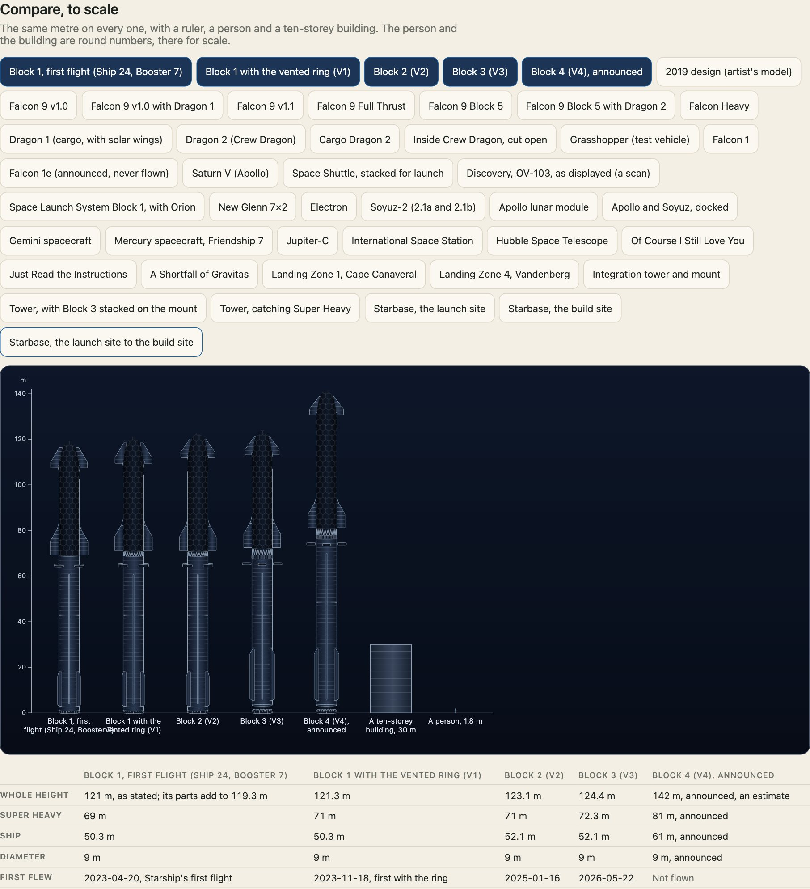
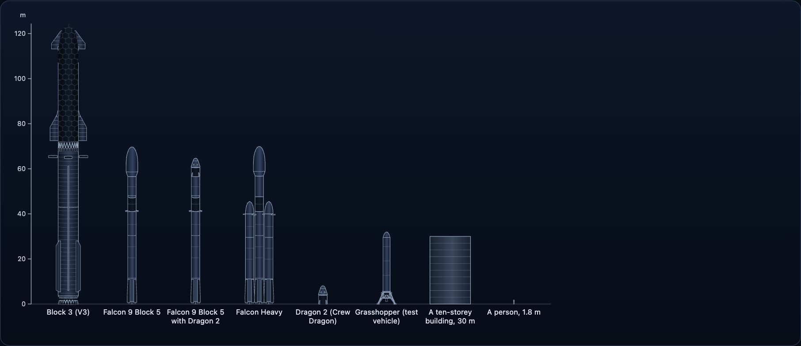

`<uchusen-lineup>` は、ロケットを同じ縮尺で横に並べます。ブロック4がブロック3より高いことや、ファルコン9がスターシップのブースターの中に2本入ることが、一目でわかります。



## 要素

```html
<uchusen-lineup items="starship:v1,starship:v2,starship:v3,starship:v4,building,person" unit="3" ruler labels></uchusen-lineup>
```

| 属性 | 内容 |
| --- | --- |
| `items` | `rocket:variant` のキーの一覧と、比較用の形 `person`（人）と `building`（建物）。未知の項目は省かれます。 |
| `unit` | 1メートルあたりのピクセル数。 |
| `look`、`view`、`show` | `<uchusen-rocket>` と同じです。 |
| `ruler`、`labels` | スイッチ。縮尺の定規と、各項目の下の名前。 |

`view` で指定しない限り正面を表示します。ただし、打ち上げ形態のスペースシャトルはオービターが見えるように向きを変え、全体が黒いロケットは、暗い背景に消えないよう、彩色の見た目では細い明るい輪郭がつきます。

## SVG のテキストとして

`build` エントリーの `lineupSvg` は、DOM なしで同じ図を作ります。サーバーやビルド処理に向いています。

```ts
import { lineupSvg } from "@johnmorrisdotca/uchusen-rockets/build";

const picture = lineupSvg({ items: ["starship:v3", "falcon-9:block-5", "person"], unit: 4, ruler: true, labels: true });
console.log(picture.width, picture.height, picture.svg.startsWith("<svg"));
console.log(picture.items.map((item) => `${item.label}: ${item.height} m`));
```

## 比較用の形

人（1.8 m）と10階建てのビル（30 m）は、縮尺の目安として切りのよい大きさにしたもので、何かの事実ではありません。

```ts
import { COMPARES } from "@johnmorrisdotca/uchusen-rockets/build";

console.log(COMPARES);
```

## すべてのロケットを同じ縮尺で



ほかのメーカーのロケットも同じ縮尺を共有し、それぞれが自分の出典を示します。高さはすべて出典つきの `Figure` なので、並べた図にデータにない大きさが出ることはありません。出典つきの高さがない型式は、推測で描かずに省かれます。
