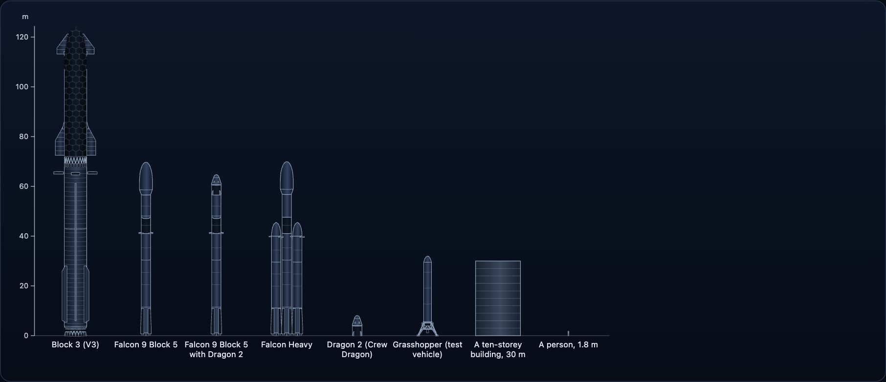

ロケットは変わります。スターシップのブロック1とブロック3は別物ですし、2012年のファルコン9とブロック5も別物です。そのためこのパッケージには、単一の「ファルコン9」はなく、出典が記録している型式ごとに、それぞれ固有の寸法があります。



## 数値は出典を示すか、空欄にする

データのすべての寸法・数・日付は `Figure` です。値、その出典の id、出典に日付があればその日付を持ちます。出典のない数値は空欄（`value` が `null`）で、隙間を埋めるために推定されることはありません。

```ts
import { SOURCES, variantOf } from "@johnmorrisdotca/uchusen-rockets";

const v3 = variantOf("starship", "v3");
const height = v3?.facts.height;
console.log(height?.value, height?.source, height?.source ? SOURCES[height.source].url : "");
```

`SOURCES` はすべての id が指す表で、題名、発行元、URL、ページの日付、直接読んだのか、検索で見つけたのか、他のページに引用されていたのかを持ちます。

## 出典が食い違うとき

出典どうしが一致しないこともあります。その数値は選んだ値を保持し、ほかの値は `others` に、誰がそう言ったか、なぜ選ばなかったかとともに並べます。

```ts
import { variantOf } from "@johnmorrisdotca/uchusen-rockets";

const booster = variantOf("starship", "v3")?.facts.parts.booster;
for (const other of booster?.others ?? []) console.log(other.value, other.source, other.note);
```

## 数値の横に必ず添える言葉

発表されただけで造られていない数値や、全体を語らない形で述べられた数値があります。そうした数値には `brief` があり、どこに表示されても値の横に残さなければならない短い言葉です。`figureWords` は、表に載せるのにふさわしい形で数値を文字にします。

```ts
import { figureWords, variantOf } from "@johnmorrisdotca/uchusen-rockets";

const v4 = variantOf("starship", "v4");
console.log(v4?.status, figureWords(v4?.facts.height, " m"));
```

ブロック4は発表されただけで造られていないため、高さは推定値として表示されます。実測した寸法と取り違えられることはありません。

## 国と、必要なら国旗

作られたロケットにも計画中のロケットにも `country` があります。これは数値で、値は ISO 3166-1 alpha-2 のコード（`US`、`RU`、`CN`）です。コードはそれぞれのロケットの記事から取りました。複数の国や国際機関のもの（アポロ・ソユーズ、ISS、ハッブル、Ariane 6）、出典に開発国が2つ書かれているもの（Electron）、それに SPX の船団の船には、コードがありません。値は `null` で、その理由は `note` に書いてあります。`MAKER_COUNTRIES` はメーカーのグループごとのコード、`COUNTRY_CODES` は ISO 3166-1 で決められているすべてのコードの一覧です。

```ts
import { countryOf, ROCKETS } from "@johnmorrisdotca/uchusen-rockets";

console.log(ROCKETS["falcon-9"]?.country.value, countryOf("iss").value, countryOf("iss").note);
```

要素に `flags` 属性を付けると、絵の隅、ロケットの横にロケットの国旗を出します。国旗をロケットに重ねて描くことはありません。国旗は `@johnmorrisdotca/hata` のもので、入れなくてもよい peer 依存です。入れておくと、国旗が初めて必要になったときに、要素が動的インポートで読み込みます。入れていなければ、要素はこれまでどおり描かれ、国旗もエラーも出ません。`setFlagLoader` を使うと、ページに出す国旗だけを読み込むモジュールなど、自分で用意したモジュールを渡せます。

## ステータス

型式の `status` は `flown`、`announced`、`artist-model`、`test-vehicle`、`support` のいずれかです。実在の型式として表示されるロケットは、その型式に当てはまる部品だけを使います。部品を混ぜたものはカスタム構成であり、そう明記されます。

## 一つの種類に三台の車：ロードスター

`roadster` は「モデルには、描いているものの名前を付ける」という決まりの例です。三台は横一列に並んでいて、クリックで選びます。`first-generation` は実際に宇宙へ行った車で、運転席にはスターマンが座っています。`status: "flown"` です。`second-generation` の二つのモデルは `status: "announced"` です。2017年に試作車として発表されましたが、宇宙へは行っていません。そのことはメモにも書いてあります。どの車も出典のある数値に合わせて大きさを決めています。一台目は全長に、ほかの二台はホイールベースに合わせています。出典のない寸法は空欄のままです。

```ts
import { ROCKETS } from "@johnmorrisdotca/uchusen-rockets";

for (const variant of ROCKETS.roadster.variants) console.log(variant.id, variant.status, variant.facts.sizes?.Wheelbase?.value);
```

## 何があるかを調べる

`ROCKETS` は id をキーとするレコードです。各項目は型式を順に並べ、既定の型式を示します。

```ts
import { ROCKETS } from "@johnmorrisdotca/uchusen-rockets";

for (const rocket of Object.values(ROCKETS).slice(0, 5)) console.log(rocket.id, rocket.variants.map((variant) => variant.id).join(" "));
```

`PLANNED_ROCKETS` は、出典つきの事実はあるがまだ形のないロケットを並べています。

## 深宇宙の機体

ボイジャーとジュノーは宇宙を飛ぶので、視点は90度まで傾けられます。ボイジャーの模型は1つで1号と2号の両方を表します。塗装した見た目はNASAの模型で、高利得アンテナが3.7メートルになるよう縮尺しています。線画はこのパッケージ自身の形で、公表されているアンテナ、筐体、高さ、磁力計のブームから描きます。ジュノーの塗装した見た目はNASAの模型で、太陽電池の幅が20メートルになるよう縮尺しています。線画は公表されている本体、20メートルの幅、電池板の幅を使います。ジェイムズ・ウェッブの塗装した見た目はNASAの模型で、サンシールドの長い辺が21.197メートルになるよう縮尺しています。線画はそのサンシールド（幅14.162メートル）と6.5メートルの主鏡を使います。パーカー・ソーラー・プローブの塗装した見た目はNASAの模型で、熱シールドが2.4メートルになるよう縮尺しています。線画は公表されている高さ3メートル、本体の直径1メートル、その熱シールドを使います。カッシーニの塗装した見た目はNASAの模型で、ハイゲインアンテナが4メートルになるよう縮尺しています。ガリレオの塗装した見た目はNASAの模型で、最も長い辺が11メートルの磁力計ブームになるよう縮尺しています。パイオニアの塗装した見た目はNASAの模型で、ハイゲインアンテナはすでに2.74メートルです。一つの模型がパイオニア10号と11号の両方を表します。

## こういう作りにしている理由

見た目はそれらしくても10メートルずれている図は、ない方がましです。メッシュと図面は同じ出典つきの数値から作られるので、お互いにも、横にある表とも食い違いません。[設計](architecture.md)を見てください。
