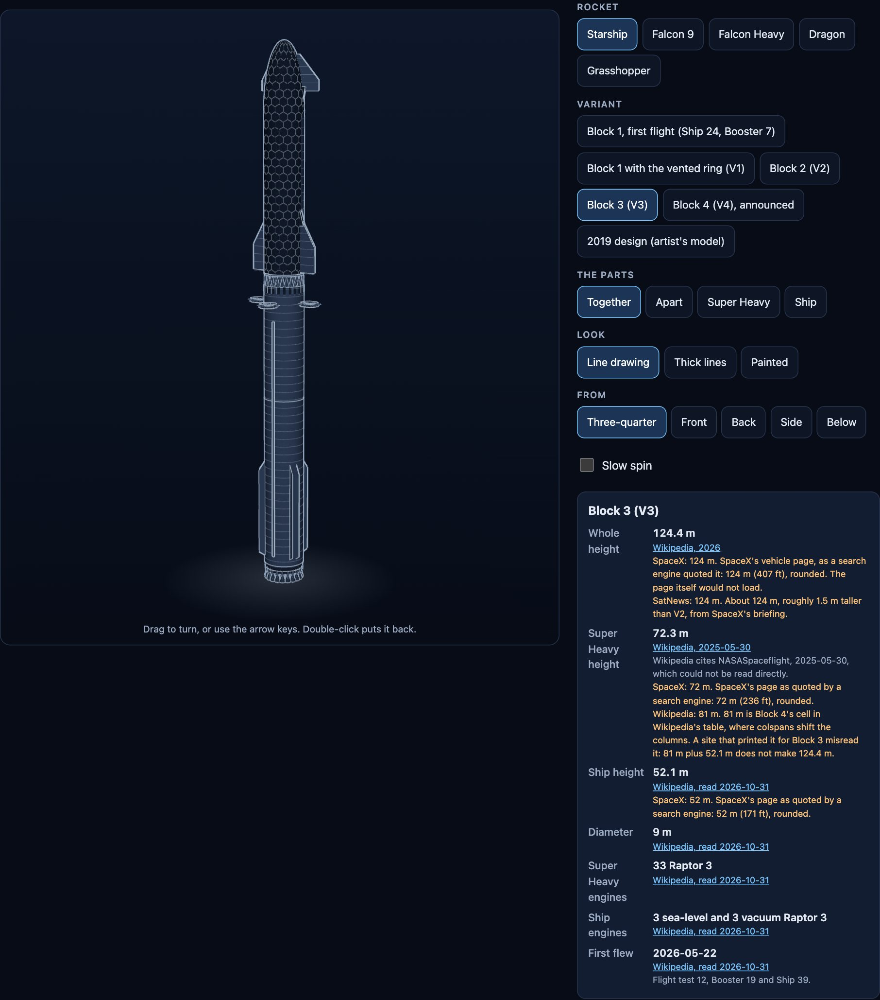
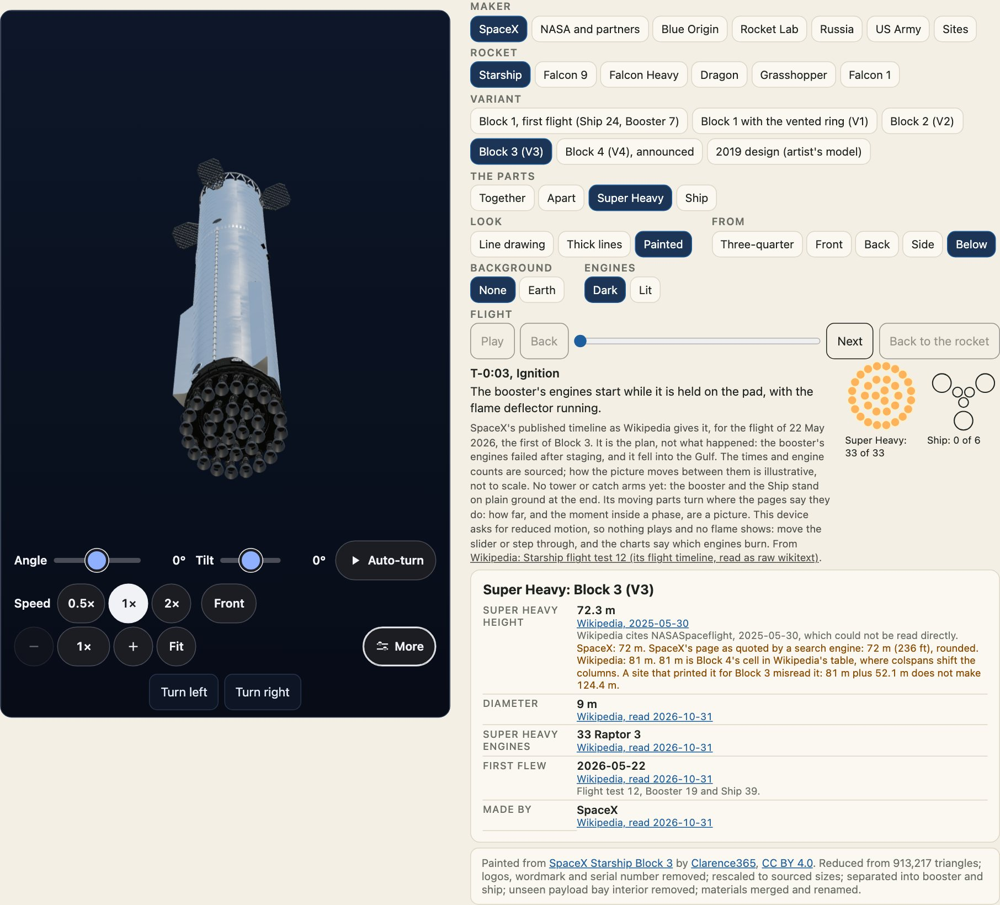
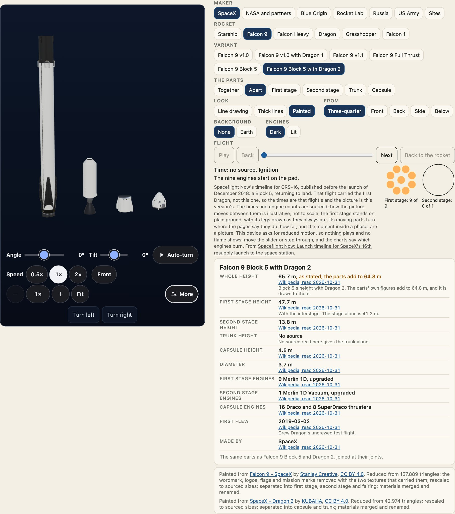

Three choices change what you see, and they are independent: **look** (how it is drawn), **view** (where from) and **show** (which parts). Every look works for every variant, together, apart and each part alone.



## Looks

| `look` | What it is |
| --- | --- |
| `line` | Thin light lines on night blue. The default. |
| `thick` | The same drawing with heavier lines, for small sizes and for print. |
| `painted` | Materials and light. A licensed model where there is one, otherwise this package's own paint. |

Changing the look keeps the angle: it changes materials, not the camera. A look is one table entry (`LOOKS`) that changes lines, colours and fills, never a shape.

```ts
import { LOOKS, LOOK_NAMES, cleanLook } from "@johnmorrisdotca/uchusen-rockets";

console.log(LOOK_NAMES, LOOKS.thick.outline, cleanLook("glossy"));
```

`cleanLook` turns anything from outside into a look's name, and gives the default for anything it does not know. The same is true of `cleanView` and `cleanShow`: a hostile or misspelt attribute draws the default and nothing else.

## Views



`view` is `three-quarter` (the default), `front`, `back`, `side` or `below`. **Front is the windward, tiled side; back is the steel side.** Each name is an angle:

```ts
import { VIEWS, VIEW_NAMES, directionOf } from "@johnmorrisdotca/uchusen-rockets";

for (const name of VIEW_NAMES) console.log(name, VIEWS[name], directionOf(VIEWS[name]).map((n) => n.toFixed(2)).join(" "));
```

Drag turns the view from the chosen angle, the arrow keys nudge it, `+` and `-` zoom, and Home or a double-click puts it back. `spin` sets a slow turn of its own: `off`, `slow`, `medium`, `fast` or seconds a turn, and `way` is `cw` or `ccw`.

## Showing parts

`show` is `together`, `apart` or the slot of one part. The slots depend on the variant.

```ts
import { showsOf, variantOf } from "@johnmorrisdotca/uchusen-rockets";

console.log(showsOf(variantOf("falcon-9", "block-5-dragon-2")?.slots ?? []));
```



Changing `show` is an animated move, and a cut for a reader who asked for reduced motion. A part alone fills the frame and lists its own size.

## In HTML, React and code

The attributes, the React props and the options are the same words.

```html
<uchusen-rocket rocket="falcon-heavy" look="thick" view="below" show="apart"></uchusen-rocket>
```

```ts
import { attributesFromOptions, optionsFromAttributes } from "@johnmorrisdotca/uchusen-rockets";

const attributes = attributesFromOptions({ rocket: "falcon-heavy", look: "thick", view: "below", show: "apart" });
console.log(attributes, optionsFromAttributes((name) => attributes[name] ?? null));
```

## Read the state from a script

`element.state` is `picture`, `loading`, `3d`, `fallback` or `error`, and `element.angle` is the current `{ az, el }`. The element sends `uchusen-ready`, `uchusen-change`, `uchusen-painted`, `uchusen-fallback` and `uchusen-error` events. See the [element reference](api:element.UchusenRocket).
