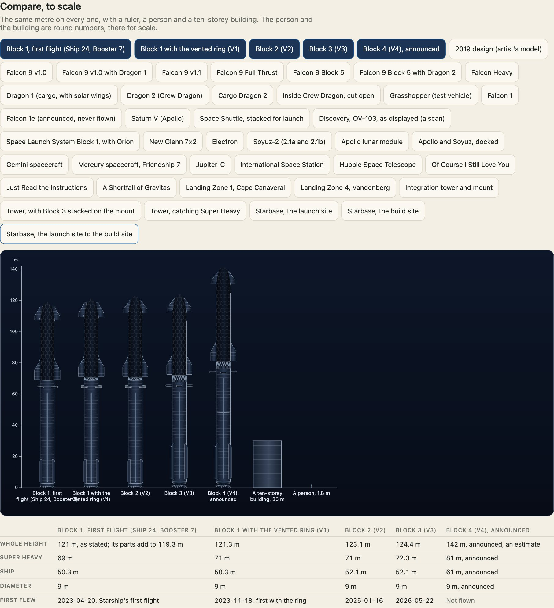
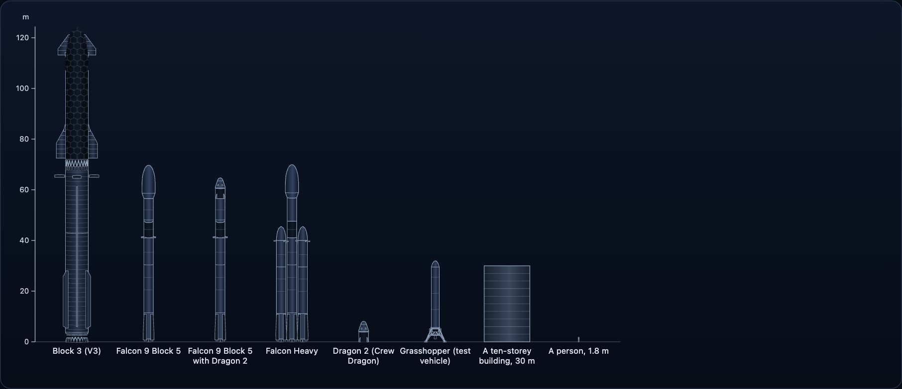

`<uchusen-lineup>` stands rockets side by side at one scale. It is how you see that Block 4 is taller than Block 3, or that a Falcon 9 would fit inside Starship's booster twice over.



## The element

```html
<uchusen-lineup items="starship:v1,starship:v2,starship:v3,starship:v4,building,person" unit="3" ruler labels></uchusen-lineup>
```

| Attribute | What |
| --- | --- |
| `items` | A list of `rocket:variant` keys, and the comparison shapes `person` and `building`. An unknown item is left out. |
| `unit` | Pixels to a metre. |
| `look`, `view`, `show` | As on `<uchusen-rocket>`. |
| `ruler`, `labels` | Switches: a scale ruler, a name under each item. |
| `real` | `on` lays Starship with Super Heavy, Saturn V, SLS and the ISS sideways in the fleet band, at the ships' own scale, each labelled with its name and length. Left out or `off`: not drawn. They come only where a fleet ship is. |

The front is what it shows unless `view` says otherwise, except that the stacked Space Shuttle is turned so its orbiter shows, and a rocket black all over takes a thin light outline in the painted look so it does not vanish on a dark ground.

## As SVG text

`lineupSvg` from the `build` entry makes the same picture with no DOM, for a server or a build step.

```ts
import { lineupSvg } from "@johnmorrisdotca/uchusen-rockets/build";

const picture = lineupSvg({ items: ["starship:v3", "falcon-9:block-5", "person"], unit: 4, ruler: true, labels: true });
console.log(picture.width, picture.height, picture.svg.startsWith("<svg"));
console.log(picture.items.map((item) => `${item.label}: ${item.height} m`));
```

## Real craft for scale

With a fleet ship in the lineup, `real="on"` (`real: true` in `lineupSvg`, which also returns them as `real`) lays four real craft in the same band, one row each, at the same scale and on the same ruler: Starship with Super Heavy, Saturn V, SLS Block 1 and the ISS. A rocket points its nose right; the station runs along its long axis. Each label is the name and the sourced length. They are the package's own models, never scaled. `REAL_CRAFT` lists them.

```ts
import { lineupSvg } from "@johnmorrisdotca/uchusen-rockets/build";

const picture = lineupSvg({ items: ["fleet-02:fleet-02"], unit: 3, filter: "fleet", labels: true, real: true });
console.log(picture.real.map((craft) => `${craft.label}: ${craft.height} m`));
```

## The comparison shapes

The person (1.8 m) and the ten-storey building (30 m) are plain round sizes, there for scale and not facts about anything.

```ts
import { COMPARES } from "@johnmorrisdotca/uchusen-rockets/build";

console.log(COMPARES);
```

## Every rocket at one scale



Other makers' rockets share the same scale, and each lists its own sources. Because every height is a sourced `Figure`, the lineup cannot show a size the data does not have: a variant with no sourced height is left out rather than guessed.
