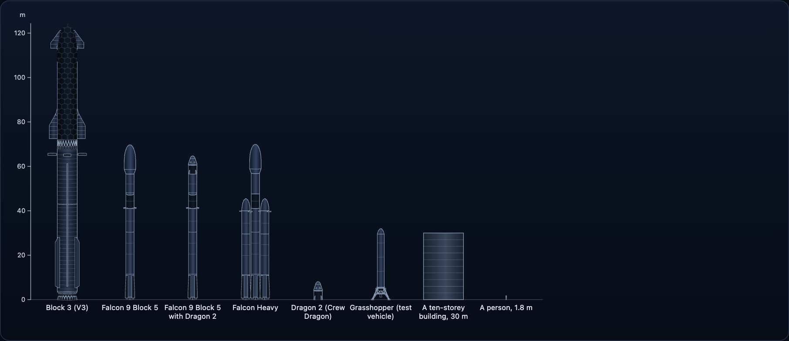

Rockets change. Starship Block 1 is not Block 3, and a Falcon 9 from 2012 is not a Block 5. So the package never has one "Falcon 9"; it has the variants a source documents, each with its own sizes.



## A figure names its source, or is blank

Every size, count and date in the data is a `Figure`: a value, the id of the source it came from, and a date where the source has one. A figure with no source is blank (`value` is `null`) and is never estimated to fill a gap.

```ts
import { SOURCES, variantOf } from "@johnmorrisdotca/uchusen-rockets";

const v3 = variantOf("starship", "v3");
const height = v3?.facts.height;
console.log(height?.value, height?.source, height?.source ? SOURCES[height.source].url : "");
```

`SOURCES` is the table every id points into: title, publisher, address, the date on the page, and whether it was read directly, found by search or cited by another page.

## Where sources disagree

Sources do not always agree. The figure keeps the value the package chose and lists the others in `others`, each with who said it and why it was not chosen.

```ts
import { variantOf } from "@johnmorrisdotca/uchusen-rockets";

const booster = variantOf("starship", "v3")?.facts.parts.booster;
for (const other of booster?.others ?? []) console.log(other.value, other.source, other.note);
```

## Words that must stay beside a number

Some figures are announced and not built, or stated in a form that is not the whole story. Such a figure has a `brief`: a few words that must stay beside the value wherever it is shown. `figureWords` writes a figure the way a table should.

```ts
import { figureWords, variantOf } from "@johnmorrisdotca/uchusen-rockets";

const v4 = variantOf("starship", "v4");
console.log(v4?.status, figureWords(v4?.facts.height, " m"));
```

Block 4 is announced, not built, so its height reads as an estimate. A reader cannot take it for a measured size.

## Statuses

A variant's `status` is `flown`, `announced`, `artist-model`, `test-vehicle` or `support`. A rocket labelled as a real version uses only parts true for it. Anything that mixes parts is a custom build and says so.

## One kind, three cars: the Roadster

`roadster` shows that a model is labelled as what it shows. Its three variants are chosen in one row. `first-generation` is the car that flew, with Starman at the wheel, `status: "flown"`. The two `second-generation` models are `status: "announced"`: shown as a prototype in 2017 and never flown, and their notes say so. Each is scaled to a sourced figure, the first to its length and the others to their wheelbase, and a size no source gives stays blank.

```ts
import { ROCKETS } from "@johnmorrisdotca/uchusen-rockets";

for (const variant of ROCKETS.roadster.variants) console.log(variant.id, variant.status, variant.facts.sizes?.Wheelbase?.value);
```

## Finding what exists

`ROCKETS` is a record by id. Each entry lists its variants in order and names its default.

```ts
import { ROCKETS } from "@johnmorrisdotca/uchusen-rockets";

for (const rocket of Object.values(ROCKETS).slice(0, 5)) console.log(rocket.id, rocket.variants.map((variant) => variant.id).join(" "));
```

`PLANNED_ROCKETS` lists rockets with sourced facts and no shape yet.

## Why it is built this way

A drawing that looks right and is wrong by ten metres is worse than no drawing. Because a mesh and a drawing come from the same sourced numbers, they cannot disagree with each other or with the table beside them. See [Architecture](architecture.md).
